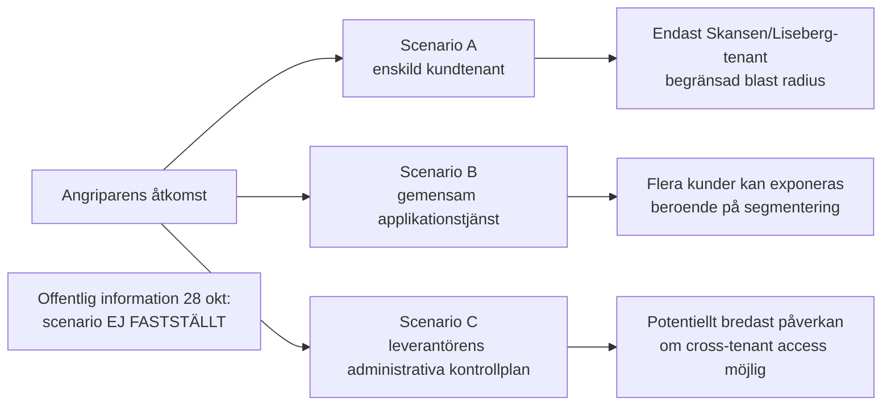
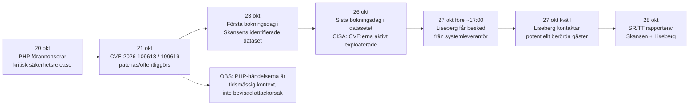

# Visit Group / iTicket – incidentrapport

**Version 1.15 · 29 oktober 2026 · Europe/Stockholm**

Detta är en **sammanhållen lägesrapport**, inte en löpande ändringslogg. Information är grupperad efter ämne och organisation. [Tidigare fullständiga versioner](./historik/) finns i arkivet. Att en verksamhet använder VISIT:s produkter innebär **inte** att den drabbats av dataintrånget.

## 1. Sammanfattning och verifieringsläge

VISIT har [bekräftat obehörig åtkomst till en begränsad mängd bokningsuppgifter i Citybreak Online](https://status.visitgroup.com/issues/6ae1d4a838e2f6f97a391a3e). Flera kunder har separat publicerat incidentbesked. **Sex namngivna verksamheter** har egna offentliga besked om Visit-relaterad påverkan eller risk: **Skansen, Liseberg, Tekniska museet, Svenska Turistföreningen (STF), Junibacken och Skånes Djurpark**. Deras formuleringar och bevisstyrka skiljer sig.

**Skansen** uppger omkring **4 800 personer**, **STF** cirka **759 bokningar** och [Göteborgs-Posten](https://www.gp.se/nyheter/goteborg/15-000-lisebergsgaster-drabbade-av-datalacka.eebf20c2-0085-53f5-a9ef-a85bb1000e4e) rapporterar **15 000 Lisebergsgäster**. Det är olika måttenheter och uppgifterna ska inte summeras till ett totalt antal unika personer. Lisebergs antal är en **medieuppgift**, inte en siffra verifierad i parkens eget offentliga besked.

**Inte fastställt:** gemensam teknisk rotorsak mellan kundernas incidenter, delad databas eller tenant, exakt exfiltrerad datamängd, angriparens identitet, ransomwarekoppling och incidentspecifika tekniska indikatorer. VISIT:s uppgift om Citybreak Online får inte utan tekniska belägg likställas med att iTicket som produkt har komprometterats.

### Översikt över berörda verksamheter

| Verksamhet | Offentligt belagd incidentuppgift | Omfattning | Säkerhetsgrad |
|---|---|---|---|
| [Skansen](https://www.skansen.se/dataintrang/) | Intrång hos biljettleverantören Visit; berörda kontaktade | Cirka 4 800 personer, enligt Skansen återgivet av SVT/TT | Hög för kundbesked |
| [Liseberg](https://www.liseberg.se/om-liseberg/bedrageri-och-sakerhet) | Varning om möjlig personuppgiftsläcka i bokningssystem | 15 000 gäster enligt GP; ej bekräftat antal i parkens eget besked | Hög för medieuppgift, lägre för oberoende verifiering |
| [Tekniska museet](https://www.tekniskamuseet.se/dataintrang/) | Visit-intrång och möjlig exponering av bokningsuppgifter | Antal ej offentligt fastställt | Hög |
| [STF](https://www.svenskaturistforeningen.se/om-stf/aktuellt/information-om-sakerhetsincident-hos-var-bokningsleverantor/) | Incident hos bokningsleverantören Visit | Cirka 759 bokningar, inte personer | Hög |
| [Junibacken](https://www.junibacken.se/uppgifter-om-dataintrang-28-oktober-2026/) | Visit-relaterat intrång; berörda informerats | Antal ej fastställt | Hög |
| [Skånes Djurpark](https://www.skanesdjurpark.se/) | Eget besked om intrång hos biljettleverantören Visit Group; berörda mejlade | Antal ej fastställt | Hög för indexerat kundbesked, begränsad direktläsning |

## 2. Kundpåverkan och offentliga besked

### Skansen

[Skansens incidentinformation](https://www.skansen.se/dataintrang/) uppger att leverantören Visit drabbats, att andra Visit-kunder också påverkats och att berörda har kontaktats. [SVT/TT den 28 oktober](https://www.svt.se/nyheter/inrikes/misstankt-dataintrang-mot-nojesparker) återger uppgiften om **cirka 4 800 personer** med bokningar **23–26 oktober 2026**. Möjliga uppgifter omfattar namn, e-post, telefon och biljettköp; enligt kundens information inte personnummer eller kortuppgifter. Skansen uppger att en extern säkerhetsutredning pågår och att Visit meddelat att bristen åtgärdats. Polisanmälan var **planerad** enligt SVT/TT; genomförandet har inte oberoende verifierats.

### Liseberg

[Lisebergs säkerhetsmeddelande](https://www.liseberg.se/om-liseberg/bedrageri-och-sakerhet) varnar för möjlig exponering i bokningssystemet. [Göteborgs-Posten den 28 oktober](https://www.gp.se/nyheter/goteborg/15-000-lisebergsgaster-drabbade-av-datalacka.eebf20c2-0085-53f5-a9ef-a85bb1000e4e) rapporterar att **15 000 gäster** berörts och kopplar läckan till Visit. Uppgifterna bör tills vidare attribueras till GP, inte presenteras som oberoende tekniskt bekräftade. [TV4 den 27 oktober](https://www.tv4.se/just-nu/6HIZ55DMCVCZftChhBrbXp/misstankt-datalacka-pa-liseberg) rapporterade också om läckan. Lisebergs onlinebokning hade en separat dokumenterad störning; ett tekniskt orsakssamband med intrånget är inte fastställt.

### Tekniska museet

Enligt [museets eget besked](https://www.tekniskamuseet.se/dataintrang/) informerades verksamheten **27 oktober** om intrång hos Visit. Bokningar främst **23–26 oktober**, eventuellt även tidigare, kan ha omfattats. Identifierade berörda informerades den **28 oktober**. Museet uppger att betal- och kortuppgifter inte omfattas. Antal och exakta exponerade poster är inte verifierade.

### Svenska Turistföreningen (STF)

[STF:s incidentmeddelande](https://www.svenskaturistforeningen.se/om-stf/aktuellt/information-om-sakerhetsincident-hos-var-bokningsleverantor/) anger omkring **759 berörda bokningar**, huvudsakligen **23–26 oktober**. Detta är **bokningar**, inte ett bekräftat antal personer. STF uppger att exakt vilka uppgifter som hämtats ut ännu inte är klarlagt och att kortbetalningar hanteras separat.

### Junibacken

[Junibackens eget besked](https://www.junibacken.se/uppgifter-om-dataintrang-28-oktober-2026/) namnger Visit som bokningsleverantör, uppger att berörda informerats och att incidenten anmälts till **IMY och polisen**. Kunden uppger att inga kort- eller betalningsuppgifter omfattas. Exakt teknisk produkt, antal poster och faktisk exfiltration är inte självständigt fastställda.

### Skånes Djurpark

[Skånes Djurparks officiella webbplats](https://www.skanesdjurpark.se/) har enligt färsk sökindexering ett incidentbesked där parken uppger att den **27 oktober** informerades om intrång hos biljettleverantören Visit Group och att berörda gäster kontaktats via mejl. Uppgiften är ett **kundbesked**, inte tekniskt bevis för komprometterad Citybreak- eller iTicket-miljö. Direktläsningen av den aktuella informationsrutan var cachebegränsad.

## 3. Leverantören, system och incidentens tekniska gränser

### VISIT:s egen incidentbekräftelse

[VISIT:s statusmeddelande den 28 oktober](https://status.visitgroup.com/issues/6ae1d4a838e2f6f97a391a3e) anger obehörig åtkomst till en **begränsad mängd Citybreak Online-bokningsdata**. Leverantören uppger att åtkomsten blockerats, att berörda kunder och relevanta myndigheter underrättats och att externa experter undersöker händelsen. Enligt VISIT omfattas inte kortdata eller API-nycklar. Det är leverantörens redovisning, inte en publicerad oberoende forensisk rapport.

### VISIT, iTicket, Citybreak och andra produkter

VISIT-koncernen tillhandahåller flera boknings- och hotellprodukter, bland annat **iTicket, Citybreak, BookVisit, VisBook, Travia och Godo**. Att två verksamheter använder iTicket eller att ett hotell använder VisBook visar en leverantörsrelation, **inte** gemensam databas, tenant, exponerad information eller angreppsyta. Den offentligt namngivna komprometterade produkten i leverantörens besked är **Citybreak Online**.

#### Dokumenterade relationer och arkitektur

#### Visit Group International AB och iTicket

Den juridiska leverantör som återkommer i de svenska upphandlingarna är **Visit Group International AB, organisationsnummer 556559-7423**. Bolaget har under 2026 gått mot varumärket **VISIT**, medan iTicket fortsätter som produktnamn för biljett- och upplevelseplattformen. 

iTicket beskriver sin lösning som en **sammanhängande molnbaserad plattform** för bland annat e-handel, biljetter, POS, självservice, realtidslager, paket med boende och externa distributionskanaler. Plattformen kan integrera externa leverantörer genom API och stöder betalningsleverantörer som Nets, Adyen, Klarna och Swedbank Pay. Detta beskriver produktens kapacitet; det betyder inte att alla kunder använder samma konfiguration eller samma betalningsleverantör. 

Det är särskilt viktigt i incidentanalysen. Att iTicket är en “core platform” och molntjänst kan innebära gemensamma applikationskomponenter, men följande lager kan fortfarande vara separerade:

```text
gemensam applikationskod
        │
        ├── tenant A / Skansen
        │      └── databas/schema A ?
        │
        ├── tenant B / Liseberg
        │      └── databas/schema B ?
        │
        └── tenant C / annan kund
               └── databas/schema C ?
```

Frågetecknen är avgörande. **Visit har inte offentligt beskrivit iTickets tenant- eller databasarkitektur på en nivå som gör det möjligt att avgöra om Skansen och Liseberg delar fysisk databas, logisk databas, schema, kluster eller endast applikationsplattform.**

#### Offentliga kontrakt

| Organisation | Leverantör | System/upphandling | Offentligt känt kontraktsvärde | Datum | Incidentstatus |
|---|---|---|---:|---|---|
| **Skansen** | Visit Group International AB | Ticketing / iTicket | **27,6 MSEK** | Tilldelning 23 maj 2025; TED-publicering 27 juni 2025; uppgivet avtal till 31 maj 2029 | **Bekräftad obehörig åtkomst till kunduppgifter**.  |
| **Liseberg AB** | Visit Group International AB | Ticketing / iTicket | **74 MSEK** enligt tilldelningsdata | Kontrakt 13 januari 2023 | **Möjlig personuppgiftsläcka; intrång utreds**.  |
| **Borås Djurpark & Camping AB** | Visit Group International AB | Biljettsystem | Ej fastställt i det material som granskats | Tilldelning 28 september 2026 | **Ingen offentlig bekräftelse på påverkan**.  |

Lisebergs 2023-projekt beskrevs som en bred digital lösning som omfattade bland annat onlineförsäljning, kassor/POS, kanalhantering och säsongskort, och iTicket lanserades som den valda plattformen. 

Skansen är ännu tydligare att verifiera i dag: den publika kundvagnen på `tickets.skansen.se` är indexerad som **Skansen Online Varukorg** och anger i sökresultatet **“Powered by iTicket a part of Visit Group”**. 

#### Offentligt identifierbara iTicket-kunder

En bokstavligt fullständig kundförteckning kan inte tas fram från öppna källor eftersom iTicket inte publicerar sitt kompletta kundregister. Den nuvarande iTicket-sidan visar **18 namngivna/logotypmärkta varumärken och därefter “+120 more”**. Den offentliga listan som går att verifiera från sidan är:

| Offentligt visat namn | Typ av belägg |
|---|---|
| Liseberg | iTicket “Trusted by leading brands” + svensk upphandling |
| Alpinco | iTicket kundlogotyp och kundcitat |
| Brim | iTicket kundlogotyp; exakt juridiskt bolagsnamn anges inte i den granskade sidan |
| Best Arctic | iTicket kundlogotyp och success story |
| The Fjords | iTicket kundlogotyp och success story |
| Norway's Best | iTicket kundlogotyp |
| Geilo | iTicket kundlogotyp; exakt juridisk entitet ej specificerad |
| Fjellheisen | iTicket kundlogotyp |
| Flåmsbana | iTicket kundlogotyp |
| Stromma Group | iTicket kundlogotyp och success story |
| Historie | Logotypetikett på iTicket; juridisk entitet oklar i det granskade materialet |
| ICEHOTEL | iTicket kundlogotyp |
| Junibacken | iTicket kundlogotyp |
| Rødne | iTicket kundlogotyp |
| Skans | Logotypetikett enligt sidan; exakt entitet ej säkerställd |
| Skånes Djurpark | iTicket kundlogotyp; även Lund Gruppen-kundcase |
| Universeum | iTicket kundlogotyp och success story |
| Voss | iTicket kundlogotyp; exakt entitet ej specificerad |

Samtliga namn ovan återfinns i iTickets nuvarande kundsektion. 

Därutöver visar iTickets egna kundcase **Lund Gruppen**, vars lösning omfattar **Kongeparken i Norge och Skånes Djurpark i Sverige**, samt **Lofsdalen**, **O'Gliss Park/Oceano Loisirs**, Stromma, Best Arctic, The Fjords och Universeum. 

**Skansen** ska läggas till denna OSINT-lista eftersom Skansens egen aktuella biljettmiljö identifierar iTicket som teknisk plattform. **Borås Djurpark** ska däremot i nuläget klassas som “kontrakterad Visit-kund”; tilldelningen i september 2026 visar leverantörsrelationen men bevisar inte att produktionsmigreringen till samma iTicket-miljö var färdig när intrånget skedde. 

Visit/VISIT uppger över **10 000 kunder i 150+ länder**, men detta omfattar den bredare portföljen med PMS, booking engine, channel manager, ticketing och andra produkter. Den siffran är alltså **inte antalet iTicket-kunder**. 

#### Vilka andra kunder kan vara drabbade?

Den tekniskt korrekta formuleringen är **“potentiellt berörda tills tenant- och incidentomfattningen är känd”**, inte “drabbade”.

För en gemensam SaaS-plattform finns åtminstone tre principiellt olika scenarier:



Det finns ännu inget offentliggjort material som placerar intrånget i scenario A, B eller C. **Tekniska museet har nu bekräftat egen möjlig exponering via Visit**, men det avgör inte vilket av scenarierna som inträffat. Det går **inte** att dra slutsatsen att Universeum, Skånes Djurpark, Stromma eller andra iTicket-kunder har exponerats enbart på grund av deras leverantörsrelation. **Junibacken har dock därefter publicerat ett eget incidentbesked om Visit, verifierat i bevakningen 28 oktober kl. 21:49; se det senaste daterade tillägget.**

## 4. Angrepp, sårbarhetshypoteser och indikatorer

### Vad vet vi om attackvektorn?

Den offentliga incidentinformationen anger **dataintrång**, men inte:

| Teknisk fråga | Offentlig status |
|---|---|
| Initial access | **Ospecificerad** |
| Exploaterad CVE | **Ospecificerad** |
| Stulna credentials | **Ospecificerat** |
| MFA-bypass | **Ospecificerat** |
| SQL injection | **Ingen uppgift** |
| RCE | **Ingen uppgift för Visitincidenten** |
| Supply-chain attack | **Ingen uppgift** |
| Komprometterat admin-konto | **Ingen uppgift** |
| API-token/API-nyckel | **Ingen uppgift** |
| Webshell | **Ingen uppgift** |
| Lateral movement | **Ingen uppgift** |
| Persistence | **Ingen uppgift** |
| Exfiltrationsmetod | **Ingen uppgift** |
| Exfiltrerad datamängd | **Okänd** |
| Antal drabbade personer | **Okänt, åtminstone offentligt för Liseberg**.  |
| Angripargrupp | **Ingen attribution** |
| Ransomware | **Ingen offentlig indikation** |
| Utpressning/darknet-publicering | **Ingen offentlig indikation hittad** |

### PHP2Shell-hypotesen

Tidsmässigheten är anmärkningsvärd men otillräcklig för attribution.

PHP:s säkerhetsteam förannonserade den **20 oktober 2026** två kritiska PHP-sårbarheter. Den **21 oktober** kom säkerhetsuppdateringar för **CVE-2026-109618** och **CVE-2026-109619**, vilka enligt PHP kan möjliggöra oautentiserad remote code execution. PHP-projektet skrev att fullständiga alternativa mitigeringar saknades och rekommenderade uppdatering. 

CISA uppdaterade därefter sin information och den **26 oktober** fördes båda sårbarheterna in i Known Exploited Vulnerabilities-katalogen, vilket innebär att faktisk exploatering i det vilda konstaterats. 

TT noterade den 28 oktober att rapporterna om Skansen och Liseberg kom kort efter att PHP-brister blivit kända. 

Men tre länkar saknas helt:

**För det första:** inget granskat tekniskt material visar att den relevanta Visit/iTicket-backenden körde en sårbar PHP-version.

**För det andra:** inga Visit-specifika loggar, exploit-paths eller IoC:er har offentliggjorts som matchar CVE-2026-109618 eller CVE-2026-109619.

**För det tredje:** ingen av Visit, Skansen eller Liseberg har offentligt tillskrivit incidenten PHP-sårbarheterna.

**Uppdatering 28 oktober kl. 09:20:** Skansen säger uttryckligen att det enligt den information de fått **inte finns någon koppling** mellan Visit-intrånget och de uppmärksammade PHP-sårbarheterna. Detta är den starkaste publicerade incidentnära uppgiften och väger tyngre än den tidigare tidsmässiga hypotesen. Inga forensiska detaljer har offentliggjorts. [Skansens incident-FAQ](https://www.skansen.se/dataintrang/).

### Incident-IoC:er

Några klassiska DFIR-IoC:er för själva Visitincidenten har inte kunnat identifieras i de offentliga källorna:

| IoC-typ | Offentlig information |
|---|---|
| Angripar-IP | Ej publicerad |
| C2-domän | Ej publicerad |
| Skadlig domän | Ej publicerad |
| Hash / malware sample | Ej publicerad |
| Webshell-filnamn | Ej publicerat |
| Angripar-user-agent | Ej publicerad |
| Exploit-URI | Ej publicerad |
| Komprometterat konto | Ej publicerat |
| Tid för initial compromise | Ej publicerad |
| Exfiltrations-IP | Ej publicerad |
| Angripargrupp | Ej attribuerad |

Det närmaste användarna har till en praktisk “indicator” är därför **social**, inte teknisk: ovanliga mejl eller sms som känner till ett verkligt Skansen-/Lisebergbesök och därefter ber mottagaren klicka på en länk, lämna uppgifter eller genomföra betalning. Lisebergs officiella råd är specifikt att vara försiktig med sådana meddelanden.

### Risk och exponerade uppgifter

### Exponerade uppgifter och risk per organisation

| Organisation | Uppgifter | Exponeringsstatus | Kort/betaldata | Incidentrelaterad risk |
|---|---|---|---|---|
| **Skansen** | Namn, adress, telefon, e-post och biljettköpsinformation enligt rapporteringen | **Obehörig åtkomst uppges ha skett**, bokningar 23–26 okt | Uppges inte omfattas | **Hög** – kontaktdata + verklig köp-/besökskontext ger bra material för övertygande phishing.  |
| **Liseberg** | Namn, e-post, telefon, adress, företagsnamn, besöksdatum | **Möjlig läcka; utreds** | Liseberg säger uttryckligen nej | **Medel–hög/Hög vid bekräftad exfiltration**.  |
| **Svenska Turistföreningen (STF)** | Exakta datafält ännu ej kända | **Cirka 759 bokningar bekräftat berörda, främst 23–26 okt; exfiltration ej klarlagd** | STF säger att kortdata lagras separat | **Okänd–hög** beroende på faktiskt hämtade data. [STF 28 okt 07:40](https://www.svenskaturistforeningen.se/om-stf/aktuellt/information-om-sakerhetsincident-hos-var-bokningsleverantor/) |
| **Tekniska museet** | Namn och e-post enligt PC för Allas 28-okt-artikel; primärkälla specificerar inte en uttömmande fältlista | **Möjlig exponering via Visit; berörda informerades 28 okt** | Museet säger nej | **Medel–hög** beroende på faktiskt utfall. [Museet](https://www.tekniskamuseet.se/dataintrang/), [PC för Alla](https://www.pcforalla.se/article/3271398/dataintrang-visit-information-om-besokare-lackt.html) |
| **Universeum** | Ingen aktuell incidentdata offentlig | Ingen bekräftad påverkan funnen | Okänt | **Okänd**, inte “låg”; samma plattform är inte tillräckligt för att bedöma incidentomfattning.  |
| **Skånes Djurpark / Lund Gruppen** | Ingen aktuell incidentdata offentlig | Ingen bekräftad påverkan funnen | Okänt | **Okänd**.  |
| **Stromma Group** | Ingen aktuell incidentdata offentlig | Ingen bekräftad påverkan funnen | Okänt | **Okänd**.  |
| **Junibacken** | Exakta berörda personuppgifter och antal ej publicerade | **Visit-intrång uttryckligen bekräftat i Junibackens eget meddelande 28 okt kl. 10:25; berörda uppges informerade; IMY- och polisanmälan uppges gjorda** | Uppges inte omfattas | **Okänd–hög** beroende på faktiska exponerade data. [Junibacken, 28 okt](https://www.junibacken.se/uppgifter-om-dataintrang-28-oktober-2026/) |
| **Borås Djurpark** | Ingen incidentdata offentlig | Ny Visit-kontraktering, produktionsstatus oklar | Okänt | **Okänd**.  |
| **Övriga iTicket-kunder** | Okänt | Ingen generell plattformsincident offentliggjord i granskat material | Okänt | **Ej bedömbar utan leverantörens tenant-scope**.  |

“Risk” i tabellen är en kvalitativ integritets-/bedrägeribedömning, inte ett CVSS-värde. Kontaktuppgifter kombinerade med korrekta besöksdatum och köpdetaljer gör det exempelvis möjligt att formulera mycket trovärdiga meddelanden i stil med “problem med din Skansenbokning den 25 oktober” eller “återbetalning för ditt Lisebergsbesök”. Det är också därför både Skansen och Liseberg varnar för nätfiske.

## 5. Driftstörningar och tillgänglighet

[VISIT:s separata WebX-incident](https://status.visitgroup.com/issues/6ae0be26cf60a849e36da5b4) omfattade **Citybreak Web, BookVisit Web och Stays**. Leverantören beskrev ett fel i delad lagring under säkerhetsförbättringar och markerade händelsen löst den **28 oktober**. Störningen ska **inte** likställas med intrångets tekniska orsak utan belägg. Liseberg rapporterade också påverkan på sin onlinebokning den 27 oktober.

### HTTP-status och driftobservationer

Vid passiv öppning av en Liseberg-bokningsadress svarade `boka.liseberg.se` vid ett tillfälle med **HTTP 429 Too Many Requests**. Det är förenligt med rate limiting eller bot-skydd och är **inte en IoC och inte ett bevis på attacker eller överbelastning**. En crawler kan själv utlösa sådan begränsning.

Det är viktigt att skilja detta från Lisebergs rapporterade incident. Lisebergs egen säkerhetssida säger att personuppgifter kan ha läckt, men ger inga tekniska loggar eller HTTP-fel som skulle kunna kopplas till angriparen.

## 6. Teknisk OSINT och verifieringsbegränsningar

### Observerad webbarkitektur

Den passiva inspektionen ger ändå flera användbara arkitektursignaler.

| Yta | Observation 28 okt 2026 | Vad den faktiskt bevisar |
|---|---|---|
| `tickets.skansen.se` | Aktuell Skansen-kundvagn; i sökindexet **“Powered by iTicket a part of Visit Group”** | Skansens publika ticketing använder iTicket.  |
| `www.skansen.se` | Separat innehålls-/marknadssajt med länkar mot biljettflödet | Frontsajt och biljettapplikation är separata publika ytor.  |
| `www.liseberg.se` | Incidentbanner i aktuell HTML; Google Tag Manager-iframe syns i det parserade dokumentet | Säkerhetsmeddelandet är live; tredjepartsresurs från Google Tag Manager förekommer.  |
| `boka.liseberg.se` | Lisebergs webbplats länkar dit för hotellbokning | Separat bokningssubdomän används. Detta bevisar inte ensamt att just den hosten är iTicket.  |
| `hotel.liseberg.se` | Länkas för rabatt-/företagskod och presentkort | Ytterligare separat Liseberg-bokningsyta.  |
| `iticket.com` | Plattformen beskriver e-handel, POS, realtidslager, paket, API-kopplingar och betalningsleverantörer | Bekräftar produktens funktionella attackyta, inte vilka komponenter som komprometterats.  |

Lisebergs aktuella HTML-extraktion visar bland annat följande externa element:

```text
iframe -> www.googletagmanager.com

Grand Curiosa Hotel:
  boka rum -> boka.liseberg.se

företags-/rabattkod:
  -> hotel.liseberg.se
```

Detta är **inte** en indikator på intrång. Google Tag Manager är en normal tredjepartskomponent. Inga observerade script- eller domänreferenser i det parserade materialet kan i sig klassas som skadliga. 

### Ett intressant Visit-infrastrukturspår hos Universeum

Ett äldre publikt, indexerat svar från Universeums bokningsmiljö på `book.universeum.se` exponerade följande build-/backendinformation:

```text
Build: 4/14/2026 2:02:24 PM
Host: CBONLINEBOTS01
DB: o3.cbguide-9177.cbischannel-42105.v1
cbraven01.visitgroup.com:8080
Controller: Todo
Action: showdetails
```

Detta material kopplar Universeums bokningsyta till en `visitgroup.com`-host och visar en explicit `DB:`-identifierare i det publikt indexerade svaret. 

Det är ett användbart OSINT-fynd, men ska **inte** övertolkas. Det gäller ett Universeum/Visit-flöde och bevisar varken att Universeum använder samma databas som Skansen/Liseberg eller att just denna komponent är del av intrånget. Tvärtom illustrerar den separata DB-identifikationen varför det inte går att anta att “samma SaaS” betyder “samma databas”.

### DNS, CNAME, headers, JavaScript, cookies och nätverkstrafik

Här finns en viktig metodbegränsning. Den lokala analysmiljön saknade fungerande extern DNS-upplösning. Passiva `curl`-försök stoppades därför **innan någon HTTP-anslutning kunde etableras**:

```text
### tickets.skansen.se
### www.skansen.se
### liseberg.se
### boka.liseberg.se
### iticket.com

curl: (6) Could not resolve host: tickets.skansen.se
curl: (6) Could not resolve host: www.liseberg.se
```

Tillgängliga lokala verktyg kontrollerades:

```text
curl       /usr/local/bin/curl
wget       /usr/bin/wget
chromium   /usr/bin/chromium
dig        NOT_FOUND
nslookup   NOT_FOUND
openssl    /usr/bin/openssl
```

Det innebär att jag **inte tillskriver några A-, AAAA- eller CNAME-poster, IP-adresser, TLS-parametrar eller HTTP-säkerhetsheaders till dessa system utan verifiering**. Att fylla i sådana värden från antaganden skulle minska rapportens tillförlitlighet.

Status för de efterfrågade tekniska artefakterna blir därför:

| Artefakt | Resultat |
|---|---|
| HTML | **Delvis verifierad** genom passiva webbfetchar. |
| Publika subdomäner | **Verifierade** genom aktuella länkar/index: bl.a. `tickets.skansen.se`, `boka.liseberg.se`, `hotel.liseberg.se`.  |
| Tredjepartsscript/iframe | **Google Tag Manager verifierat på Liseberg**.  |
| JavaScript-bundles | Inte tillräckligt exponerade i tillgänglig parser för säker inventering. |
| API-endpoints | Ingen incidentrelevant publik endpoint kunde verifieras. iTicket stöder API-integrationer generellt.  |
| Cookies | Cookiefunktioner finns, men exakta cookie-namn/värden kunde inte tillförlitligt enumereras. |
| Network/HAR | Ingen fullständig browser-HAR kunde samlas på grund av nätverksbegränsningen. |
| HTTP response headers | Inte verifierade från egen shell-session. |
| DNS A/AAAA/CNAME | Inte verifierade från egen resolver. |
| TLS-certifikat | Inte verifierade från egen `openssl`-session. |
| Intrångsspecifika IP-adresser/domäner/hashar | **Inga publikt publicerade hittade.** |

Det är en viktig skillnad mellan en **teknisk OSINT-rapport** och en riktig DFIR-utredning. För att fastställa attackvägen krävs normalt leverantörens reverse-proxy-/WAF-loggar, applikationsloggar, IAM-auditloggar, databasaudit, EDR-data, cloud control-plane-loggar och eventuella snapshots. Inget av detta är offentligt tillgängligt i nuläget.

## 7. Kartlagda kundrelationer – inte automatiskt drabbade

Detta register omfattar dokumenterade iTicket-referenser, andra VISIT-produkter, historiska kunduppgifter och vissa koncernrelationer. **Ingen bekräftad påverkan** betyder endast att offentlig bekräftelse inte hittats. Tabellen är inte en lista över komprometterade system.

### Sverige

| Verksamhet | Relation / belägg | Incidentstatus |
|---|---|---|
| Skansen | iTicket | Bekräftad exponering |
| Liseberg | iTicket | Möjlig exponering |
| Universeum | iTicket | Ingen bekräftad påverkan |
| Junibacken | iTicket-kundrelation sedan tidigare; Visit namnges uttryckligen som bokningsleverantör i [eget incidentbesked 28 okt kl. 10:25](https://www.junibacken.se/uppgifter-om-dataintrang-28-oktober-2026/). Exakt komprometterad produkt/tenant ej belagd. | **Bekräftat Visit-relaterat incidentbesked; berörda informerade enligt Junibacken; IMY- och polisanmälan uppges gjorda. Exfiltration/antal ej verifierade.** |
| Tekniska museet | Visit, uttryckligen bekräftad biljettleverantör 28 okt 2026; produkt/tenant ej fastställd i incidentmeddelandet | **Bekräftad Visit-incident hos leverantören; möjlig exponering av museets besökaruppgifter. Berörda har informerats 28 okt.** |
| Svenska Turistföreningen (STF) | Visit är bokningsleverantör för boenden och aktiviteter enligt STF:s eget incidentmeddelande 27–28 okt 2026; specifik produkt/tenant ej verifierad | **Cirka 759 bokningar, främst 23–26 okt, bekräftat berörda av Visit-intrånget; vilka data som hämtats ut och antal personer ännu okänt.** |
| **Gotland Promotion** | [Sirvoys dokumentation, 26 juni 2026](https://help.sirvoy.com/setting-up-new-channels/connect-sirvoy-to-bookvisit-or-citybreak-partners): uttryckligen namngiven Citybreak (Visitgroup)-partner; aktiv drift ej separat verifierad | **Ingen bekräftad påverkan** |
| **Destination Österlen** | [Sirvoys dokumentation, 26 juni 2026](https://help.sirvoy.com/setting-up-new-channels/connect-sirvoy-to-bookvisit-or-citybreak-partners): uttryckligen namngiven Citybreak (Visitgroup)-partner; aktiv drift ej separat verifierad | **Ingen bekräftad påverkan** |
| Nordens Ark | iTicket-referens | Ingen bekräftad påverkan |
| Skånes Djurpark | iTicket; separat officiellt Visit-relaterat incidentbesked | **Kundbesked om påverkan, antal okänt** |
| ABBA The Museum | iTicket-kundcase | Ingen bekräftad påverkan |
| Avicii Experience | iTicket-kundcase | Ingen bekräftad påverkan |
| ICEHOTEL | iTicket | Ingen bekräftad påverkan |
| Ästad Vingård | Visit Group: BookVisit och VisBook (officiellt kundcase, inte belagd iTicket-användning) | Ingen bekräftad påverkan |
| Strömma Kanalbolaget | Stromma Group/iTicket | Ingen bekräftad påverkan |
| Oceanbus | Historisk Visit-referens | Ingen bekräftad påverkan |
| Lofsdalen | iTicket-kundcase | Ingen bekräftad påverkan |
| Borås Djurpark | Visit-upphandling, drift ej verifierad | Ingen bekräftad påverkan |
| Pop House Hotel | Visit/BookVisit | Ingen bekräftad påverkan |
| Hasselbacken | Visit/BookVisit | Ingen bekräftad påverkan |
| Cirkus | Koncernkoppling, produkt ej verifierad | Ingen bekräftad påverkan |
| SPACE | Koncernkoppling, produkt ej verifierad | Ingen bekräftad påverkan |
| **ESS Group** | VISIT:s [plattformssida](https://visit.com/platform) och [kundberättelse](https://visit.com/blog/start-small-then-say-welcome-back) bekräftar VISIT-relation och VisBook-användning i koncernen. Enligt [Guest XP](https://guestxp.io/blog/ellery-beach-house-guest-experience) 14 destinationer; varje enskild anläggnings produkt ej verifierad. | **Ingen bekräftad påverkan** |
| **Ellery Beach House** (ESS Group) | [Guest XP:s kundcase](https://guestxp.io/blog/ellery-beach-house-guest-experience): VisBook PMS och BookVisit, namngiven anläggning. | **Ingen bekräftad påverkan** |
| **Lotus Hotel Group** (fyra hotell) | [VISIT Summit 2026](https://visit.com/summit) och [HotelTechReport VISIT PMS](https://hoteltechreport.com/operations/property-management-systems/visit-pms) namnger koncernen som VISIT-/VisBook-referens. Fyra anläggningar enligt [Lotus egen lista](https://lotushotelgroup.se/lotus-member/): Arken Hotel & Art Garden Spa, Hôtel Eggers, Varbergs Stadshotell & Asia Spa och Billingehus; enskild produktinstallation per hotell ej verifierad. | **Ingen bekräftad påverkan** |
| **Vadstena Klosterhotell** | Namngiven hotellreferens i [VISIT Summit 2026](https://visit.com/summit), också namngiven av [Guest XP](https://guestxp.io/). Exakt VISIT-produkt ej fastställd. | **Ingen bekräftad påverkan** |
| **Mössebergs Kurort** | VISIT:s officiella [kundcase](https://visit.com/success-stories/mossebergs-kurort): VisBook PMS och BookVisit bokningsmotor | Ingen bekräftad påverkan |
| **Hotel Ranten** | Ingår i samma grupp som Mössebergs Kurort; [kundcaset](https://visit.com/success-stories/mossebergs-kurort) anger samma VISIT-PMS vid alla tre anläggningar | Ingen bekräftad påverkan |
| **Mössebergs Camping** | Samma uttryckligen dokumenterade VISIT-PMS som Mössebergs Kurort och Hotel Ranten enligt [kundcase](https://visit.com/success-stories/mossebergs-kurort) | Ingen bekräftad påverkan |
| **Lisebergsbyn** | VISIT:s [kundcase](https://visit.com/success-stories/lisebergsbyn) bekräftar VisBook PMS för boendeverksamheten; inte bevis för samma iTicket-miljö som Lisebergsparken | Ingen bekräftad påverkan |
| **Arctic Bath** | VISIT:s [kundcase](https://visit.com/success-stories/arctic-bath): VisBook PMS sedan 2020 och senare BookVisit bokningsmotor | Ingen bekräftad påverkan |
| **Ombergs Golf Resort** | VISIT:s [kundcase](https://visit.com/success-stories/ombergs-golf-resort): VisBook PMS | Ingen bekräftad påverkan |
| **Hooks Herrgård** | VISIT:s [kundcase](https://visit.com/success-stories/hooks-herrgard): BookVisit bokningsmotor | Ingen bekräftad påverkan |
| **Slipens Hotell** | VISIT:s [kundcase](https://visit.com/success-stories/slipens-hotell): VisBook PMS och BookVisit bokningsmotor | Ingen bekräftad påverkan |
| **Strandflickorna** | VISIT:s [kundcase](https://visit.com/success-stories/strandflickorna): VisBook PMS | Ingen bekräftad påverkan |
| **Dömle Herrgård** | VISIT:s [kundcase](https://visit.com/success-stories/domle-herrgard): VisBook PMS och internetbokningsmotor | Ingen bekräftad påverkan |
| **Hackholmssund** | VISIT:s [kundcase](https://visit.com/success-stories/hackholmssund): VisBook PMS | Ingen bekräftad påverkan |
| **Mora Hotel & Spa** | Namngiven direktkund i VISIT:s [officiella kundcaseförteckning](https://visit.com/success-stories); specifik produkt ej fastställd vid denna kontroll | Ingen bekräftad påverkan |
| **Jula Hotell** | VISIT:s [kundcase](https://visit.com/success-stories/jula-hotell): VisBook PMS och BookVisit; fem namngivna anläggningar: Skara Konsthotell, Skara Stadshotell, Gyllene Uttern, Gysinge Herrgård, Skara Stadscamping. Räknas här som en kundgrupp, inte fem nya kontrakt. | Ingen bekräftad påverkan |

### Norge

| Verksamhet | Relation / belägg | Incidentstatus |
|---|---|---|
| Alpinco | iTicket | Ingen bekräftad påverkan |
| Hafjell | Alpinco/iTicket | Ingen bekräftad påverkan |
| Kongeparken | iTicket-kundcase | Ingen bekräftad påverkan |
| Unike Hoteller (20 hotell) | VISIT Group, bokning/distribution enligt branschpress 2 juni 2026; enskilda installationer och iTicket ej verifierade | Ingen bekräftad påverkan |
| Classic Norway Hotels | Travia, del av VISIT Group; distributionsavtal enligt kundens pressmeddelande 28 aug 2025; iTicket ej belagt | Ingen bekräftad påverkan |
| Norway's Best | iTicket | Ingen bekräftad påverkan |
| Flåmsbanan | iTicket | Ingen bekräftad påverkan |
| The Fjords | iTicket-kundcase | Ingen bekräftad påverkan |
| Fjellheisen | iTicket | Ingen bekräftad påverkan |
| Geilo | iTicket | Ingen bekräftad påverkan |
| Voss | iTicket | Ingen bekräftad påverkan |
| Rødne | iTicket | Ingen bekräftad påverkan |
| Best Arctic | iTicket-kundcase | Ingen bekräftad påverkan |
| Brim Explorer | iTicket (Brim) | Ingen bekräftad påverkan |
| **Gausta (resort)** | [VISIT:s eget kundcase](https://visit.com/success-stories/gausta): All-in-One PMS (VisBook) och GetFOOD. Ingen iTicket-/Citybreak-användning belagd av källan. | **Ingen bekräftad påverkan** |
| Gaustabanen | Extern teknikidentifiering | Ingen bekräftad påverkan |
| The Whale (Andenes) | VISIT:s egna boknings- och webbflöden, bekräftat 7 oktober 2026; specifik iTicket-tenant ej styrkt | Ingen bekräftad påverkan |
| De Historiske | Visit Groups BookVisit/VisBook och distributionslösningar; organisation, inte en enda iTicket-tenant | Ingen bekräftad påverkan |
| Finnskogtoppen Spa & Wellness | Direkt belagd BookVisit/VisBook-användning, medlem i De Historiske | Ingen bekräftad påverkan |
| Color Line | Extern Visit-teknikidentifiering | Ingen bekräftad påverkan |

### Övriga länder

| Verksamhet | Relation / belägg | Incidentstatus |
|---|---|---|
| O'Gliss Park | Frankrike, iTicket-kundcase | Ingen bekräftad påverkan |
| O'Fun Park | Frankrike, koncernrelation | Ingen bekräftad påverkan |
| O'Tel | Frankrike, koncernrelation | Ingen bekräftad påverkan |
| Stromma Group | Flera länder, iTicket-kundcase | Ingen bekräftad påverkan |
| Viking Line | Sverige/Finland, historisk SaaS-referens | Ingen bekräftad påverkan |
| Nordic Choice Hotels / Strawberry | Norden, historisk SaaS-referens | Ingen bekräftad påverkan |
| Hindsgavl | Danmark, extern Visit-teknikidentifiering | Ingen bekräftad påverkan |
| Wasaline | Finland/Sverige, Citybreak enligt Visit Groups kundmeddelande 20 augusti 2026 | Ingen bekräftad påverkan |
| Iso-Syöte | Finland, Citybreak enligt Visit Groups kundmeddelande 22 maj 2026 | Ingen bekräftad påverkan |
| Kokkedal Slot | Danmark, VisBook och BookVisit enligt VISIT:s eget kundcase | Ingen bekräftad påverkan |
| Brittany Ferries | Frankrike/Storbritannien, strategiskt avtal om Visit Groups bokningsplattform enligt pressmaterial 2025; produktionsstatus ej verifierad | Ingen bekräftad påverkan |
| **Exeter Hotel** | Island, VISIT:s [kundcase](https://visit.com/success-stories/exeter-hotel): Travia för agentdistribution och gruppbokning | Ingen bekräftad påverkan |
| **Efstidalur Farm Hotel** | Island, VISIT:s [kundcase](https://visit.com/success-stories/efstidalur-farm-hotel): Godo Property, Travia och Pronto | Ingen bekräftad påverkan |
| **Hotel Ódinsvé** | Island, VISIT:s [kundcase](https://visit.com/success-stories/hotel-odinsve): Godo, Travia och Pronto | Ingen bekräftad påverkan |
| **Hotel Aldan** | Island, VISIT:s [kundcase](https://visit.com/success-stories/hotel-aldan): Godo Property och Travia | Ingen bekräftad påverkan |
| **Spa Hotel Kasnäs** | Finland, VISIT:s [kundcase](https://visit.com/success-stories/spa-hotel-kasnas): internetbokningsmotor och All-in-One PMS (produktnamn ej uttryckligen fastställt i caset) | Ingen bekräftad påverkan |

### Kompletterande relationer och källunderlag

| Kund / verksamhet | Belagd relation och primärunderlag | Säkerhetsgrad för relation | Incidentkoppling |
|---|---|---|---|
| **ESS Group** (koncern, enligt Guest XP cirka 14 destinationer) | VISIT namnger [ESS Group som kund/partner](https://visit.com/platform) och beskriver [VisBook-användning i ESS:s gästdataarbete](https://visit.com/blog/start-small-then-say-welcome-back). På [VISIT Summit 2026](https://visit.com/summit) beskrevs en kundledd demonstration av VISIT-plattformen hos ESS. | **Mycket hög** för VISIT-koncernrelation och VisBook i dokumenterad ESS-miljö; ej belagt att varje ESS-anläggning använder samma produkt. | **Ingen bekräftad påverkan.** |
| **Ellery Beach House**, Lidingö (ESS Group) | [Guest XP:s kundcase](https://guestxp.io/blog/ellery-beach-house-guest-experience) anger uttryckligen **VisBook PMS och BookVisit** för Ellery. Kundcaset beskriver Guest XP:s integration och är en tredjepartsförstahandskälla. | **Mycket hög** för namngiven anläggning och produkterna. | **Ingen bekräftad påverkan.** |
| **Lotus Hotel Group** (fyra hotell) | [VISIT Summit 2026](https://visit.com/summit) namnger Lotus bland exempel på integrerad gästresa; [HotelTechReport:s VISIT PMS-profil](https://hoteltechreport.com/operations/property-management-systems/visit-pms) namnger **Lotus Hotel Group** som VisBook-referens. [Lotus egen webbplats](https://lotushotelgroup.se/lotus-member/) anger de fyra hotellen: **Arken Hotel & Art Garden Spa**, **Hôtel Eggers**, **Varbergs Stadshotell & Asia Spa**, **Billingehus**. | **Hög** för koncernrelation och VisBook-referens. Koncerntillhörighet är bekräftad, men samma installation på alla fyra hotellen är inte separat verifierad. | **Ingen bekräftad påverkan.** |
| **Vadstena Klosterhotell** | Namnges uttryckligen i [VISIT Summit 2026](https://visit.com/summit) som hotell i demonstration av integrerad gästresa. [Guest XP:s webbplats](https://guestxp.io/) visar hotellet bland sina kunder för en produkt integrerad i VisBook/BookVisit, men bekräftar inte separat vilket VISIT-system hotellet använder. | **Medel–hög** för VISIT-ekosystemrelation; **ej tillräcklig för produkt-/tenantklassning**. | **Ingen bekräftad påverkan.** |

| Verksamhet | Belagd relation | Källtyp och säkerhetsgrad | Incidentkoppling |
|---|---|---|---|
| **Gotland Promotion** | Namngiven som Citybreak (Visitgroup)-partner i Sirvoys integrationsdokumentation. | **Hög** för dokumenterad historisk partnerrelation, utifrån namngiven tredjepartsleverantör; aktiv drift per 29 oktober inte oberoende bekräftad. | **Ingen bekräftad påverkan**, ingen exfiltration eller tenantkoppling belagd. |
| **Destination Österlen** | Namngiven som Citybreak (Visitgroup)-partner i samma dokumentation. | **Hög** för dokumenterad historisk partnerrelation; aktuell produktionsstatus ej verifierad. | **Ingen bekräftad påverkan**, ingen exfiltration eller tenantkoppling belagd. |

| Verksamhet | Land | Belagd relation | Datum för källan | Källa | Säkerhet relation / intrångskoppling |
|---|---|---|---|---|---|
| **The Whale**, Andenes | Norge | VISIT har levererat publik webbplats med integrerad biljettbokning. Försäljning inför öppning 2027 pågår; specifik iTicket-tenant inte verifierad. | 7 okt 2026 | [VISIT: The Whale – Now Bookable with VISIT](https://visit.com/insight/the-whale-now-bookable-with-visit) | Mycket hög / ingen belagd |
| **Wasaline** | Finland/Sverige | Citybreak för hotellpaketering och bokningsdistribution. | 20 aug 2026 | [VISIT: Wasaline is Future-Proofing Packaging](https://www.visitgroup.com/fi/uutiset/wasaline-future-proofing-packaging) | Mycket hög / ingen belagd |
| **Iso-Syöte** | Finland | Citybreak och Citybreak CMS för skidresortens e-handel och paketering. | 22 maj 2026 | [VISIT: Iso-Syöte Ski Resort](https://www.visitgroup.com/news/award-winning-iso-syote-ski-resort-takes-big-climb-towards-online-excellence) | Mycket hög / ingen belagd |
| **De Historiske** | Norge | Hotellorganisation som utökar samarbetet med VISIT; BookVisit/VisBook och distributions-/paketeringsmoduler. Medlemshotell ska inte automatiskt räknas som 73 separat verifierade installationer. | Publiceringsdatum ej verifierat | [VISIT: De Historiske](https://www.visitgroup.com/de-historiske-and-visit-group-set-new-standard-future-hotel-experiences) | Mycket hög / ingen belagd |
| **Finnskogtoppen Spa & Wellness** | Norge | VISIT:s kundcase identifierar konkret användning av BookVisit och VisBook inom De Historiske. | Publiceringsdatum ej verifierat | [VISIT: De Historiske, avsnitt Finnskogtoppen](https://www.visitgroup.com/de-historiske-and-visit-group-set-new-standard-future-hotel-experiences) | Mycket hög / ingen belagd |
| **Kokkedal Slot** | Danmark | VISIT:s kundcase anger BookVisit för bokningsmotor och VisBook för PMS. | Publiceringsdatum ej verifierat | [VISIT: Kokkedal Slot](https://visit.com/success-stories/kokkedal-slot) | Mycket hög / ingen belagd |
| **Brittany Ferries** | Frankrike/Storbritannien | Offentlig strategisk relation för modernisering av digital bokning; den faktiska produktionsdriften och iTicket-användning har inte verifierats. | 17 maj 2025 i branschpress | [Ferry Shipping News](https://ferryshippingnews.com/brittany-ferries-and-visit-group-join-forces-to-drive-digital-transformation-2/), [VISIT:s partnerskapsmeddelande](https://www.visitgroup.com/visit-group-welcomes-brittany-ferries-new-partner-digital-transformation-journey) | Hög / ingen belagd |

| Verksamhet | Verifierad relation | Ursprungligt källdatum | Källa | Säkerhetsgrad / incidentkoppling |
|---|---|---|---|---|
| **Unike Hoteller**, Norge | Strategiskt avtal med VISIT Group för bokning, distribution och gästhantering i en hotellkedja med **20 hotell**. Artikeln beskriver en avsedd gemensam plattform, inte en verifierad produktionsinstallation för varje hotell. **iTicket-användning ej belagd.** | **2 juni 2026 kl. 10:29** | [Hotellmagasinet – Unike Hoteller velger ny bookingplattform](https://www.hotellmagasinet.no/bookingplattform-gjestehandtering-hotellkjede/unike-hoteller-velger-ny-bookingplattform/1271953) | **Mycket hög** för avtal/relation; **ingen verifierad intrångskoppling** |
| **Classic Norway Hotels**, Norge | Hotellkedjan har offentliggjort samarbete med **Travia**, en distributionsplattform som blev del av Visit Group 2025. Avtalet omfattar utrullning i kedjans verksamheter; enskilda produktionsinstallationer och iTicket-användning **ej verifierade**. | **28 augusti 2025 kl. 14:59** | [Classic Norway Hotels – officiellt pressmeddelande](https://www.mynewsdesk.com/no/classicnorway-dot-no/pressreleases/digitalt-kvantesprang-classic-norway-hotels-inngaar-samarbeid-med-travia-3401526) | **Mycket hög** för koncernrelation; **ingen verifierad intrångskoppling** |

|---|---|---|---|---|
| Mössebergs Kurort | Sverige | VisBook PMS och BookVisit | [VISIT](https://visit.com/success-stories/mossebergs-kurort) | Mycket hög / ingen belagd |
| Lisebergsbyn | Sverige | VisBook PMS för boenden | [VISIT](https://visit.com/success-stories/lisebergsbyn) | Mycket hög / ingen belagd |
| Arctic Bath | Sverige | VisBook PMS, BookVisit | [VISIT](https://visit.com/success-stories/arctic-bath) | Mycket hög / ingen belagd |
| Ombergs Golf Resort | Sverige | VisBook PMS | [VISIT](https://visit.com/success-stories/ombergs-golf-resort) | Mycket hög / ingen belagd |
| Hooks Herrgård | Sverige | BookVisit | [VISIT](https://visit.com/success-stories/hooks-herrgard) | Mycket hög / ingen belagd |
| Slipens Hotell | Sverige | VisBook PMS, BookVisit | [VISIT](https://visit.com/success-stories/slipens-hotell) | Mycket hög / ingen belagd |
| Strandflickorna | Sverige | VisBook PMS | [VISIT](https://visit.com/success-stories/strandflickorna) | Mycket hög / ingen belagd |
| Dömle Herrgård | Sverige | VisBook PMS, internetbokning | [VISIT](https://visit.com/success-stories/domle-herrgard) | Mycket hög / ingen belagd |
| Hackholmssund | Sverige | VisBook PMS | [VISIT](https://visit.com/success-stories/hackholmssund) | Mycket hög / ingen belagd |
| Mora Hotel & Spa | Sverige | Officiellt listad kund; produkt ej verifierad | [VISIT](https://visit.com/success-stories) | Hög / ingen belagd |
| Jula Hotell | Sverige | VisBook PMS och BookVisit, koncernens fem anläggningar | [VISIT](https://visit.com/success-stories/jula-hotell) | Mycket hög / ingen belagd |
| Exeter Hotel | Island | Travia | [VISIT](https://visit.com/success-stories/exeter-hotel) | Mycket hög / ingen belagd |
| Efstidalur Farm Hotel | Island | Godo Property, Travia, Pronto | [VISIT](https://visit.com/success-stories/efstidalur-farm-hotel) | Mycket hög / ingen belagd |
| Hotel Ódinsvé | Island | Godo, Travia, Pronto | [VISIT](https://visit.com/success-stories/hotel-odinsve) | Mycket hög / ingen belagd |
| Hotel Aldan | Island | Godo Property, Travia | [VISIT](https://visit.com/success-stories/hotel-aldan) | Mycket hög / ingen belagd |
| Spa Hotel Kasnäs | Finland | VISIT:s bokningsmotor och All-in-One PMS; exakt produktbenämning ej fastställd | [VISIT](https://visit.com/success-stories/spa-hotel-kasnas) | Mycket hög / ingen belagd |

**Ytterligare belagda anläggningar:** [Mössebergs Kurorts kundcase](https://visit.com/success-stories/mossebergs-kurort) nämner även **Hotel Ranten** och **Mössebergs Camping**. **Gausta** använder enligt [VISIT:s kundcase](https://visit.com/success-stories/gausta) VisBook och GetFOOD. [Ästad Vingård](https://www.visitgroup.com/sv/news/astad-vingard-implements-visit-groups-platform-solutions-automate-operations-and-elevate-guest) är en dokumenterad BookVisit/VisBook-referens. **Inget av detta belägger intrång hos dessa verksamheter.**

### Källornas bevisvärde

### Övriga logotyper i leverantörens material
- **Historie** – namn/logotyp på iTickets webbplats; juridisk entitet oklar.
- **Skans** – logotypetikett på iTickets webbplats; juridisk entitet oklar. Ska inte automatiskt likställas med Skansen.
- **Lund Gruppen** – koncernreferens bakom bland annat Kongeparken och Skånes Djurpark.

## Bevisklassning
1. **Direkt iTicket-referens:** leverantörens kundlista, kundcase eller publik biljettlösning.
2. **Visit-produkt eller historisk referens:** annan produkt, äldre kundrelation eller extern teknikidentifiering.
3. **Koncern-/destinationsrelation:** en verksamhet inom kundgrupp; egen installation ej styrkt.
4. **Incidentstatus:** 'ingen bekräftad påverkan' betyder inte att en incident är utesluten.

## 8. Kronologisk händelsetidslinje

### Tidslinje



PHP-tidslinjen stöds av PHP och CISA; Skansen- och Lisebergdatumen stöds av Sveriges Radio, Lisebergs egen information och GP.

## 9. Metod och källkritik

Undersökningen har hållits helt på **passiv OSINT-nivå**. Informationsinhämtningen bestod av sökmotorindex, öppning av publika webbsidor, Visit/iTickets egna produkt- och kundsidor, svenska upphandlingsdata, officiella säkerhetsmeddelanden, PHP:s egen säkerhetsinformation, CISA:s vulnerability-information samt etablerade svenska nyhetsmedier. Ingen autentisering, scanning eller säkerhetsprobning mot Visit eller kundernas system utfördes.

### Exekvererade shell-kommandon

Följande passiva kommandon kördes lokalt:

```bash
for h in tickets.skansen.se www.skansen.se liseberg.se boka.liseberg.se iticket.com; do
    echo "### $h"
    getent ahosts "$h" | head -5 || true
done

curl -sSIL --max-time 10 https://tickets.skansen.se/sv/varukorg
curl -sSIL --max-time 10 https://www.liseberg.se/

for c in curl wget chromium dig nslookup openssl; do
    printf '%-10s ' "$c"
    command -v "$c" || echo 'NOT_FOUND'
done
```

DNS-upplösningen fungerade inte i körmiljön; `curl` gav:

```text
curl: (6) Could not resolve host: tickets.skansen.se
curl: (6) Could not resolve host: www.liseberg.se
```

Därför användes inga lokalt framtagna IP-, DNS-, CNAME-, TLS- eller headeruppgifter i slutsatserna.

### Exakta OSINT-sökfrågor

Följande söksträngar kördes under undersökningen, bland annat för att försöka fånga både svenska incidentmeddelanden, leverantörskopplingar, upphandlingsdata, plattformsreferenser och möjliga andra drabbade organisationer:

```text
site:skansen.se dataintrång biljettleverantör oktober 2026 Visit Group
site:liseberg.se dataintrång bokningssystem oktober 2026 Visit Group
Visit Group dataintrång oktober 2026 Skansen Liseberg
Visit Group cyberattack breach October 2026 ticketing Sweden

Skansen kunduppgifter läckt biljettleverantör 27 oktober 2026
Liseberg kunduppgifter läckt bokningsleverantör 27 oktober 2026
Skansen Liseberg personuppgifter läcka 2026 Visit Group
"Visit Group" "Skansen" "Liseberg" 2026

site:skansen.se "23 och 26 oktober" Visit personuppgifter
site:skansen.se "Visit" "personuppgifter" "oktober" 2026
site:liseberg.se "personuppgifter" "27 oktober 2026" bokning
site:liseberg.se "dataintrång" "2026" Visit Group

"Liseberg" "Visit" "23" "26 oktober" 2026 personuppgifter
"Liseberg" "Visit Group" "personuppgifter" 2026
"Liseberg" "namn" "e-post" "telefonnummer" "postadress" 2026 läcka
"Skansen" "namn" "e-post" "telefonnummer" "Visit" 2026

site:visitgroup.com Liseberg Visit Group ticketing
site:visitgroup.com Skansen Visit Group ticketing
site:visitgroup.com "Liseberg" "Skansen"
site:visitgroup.com customers attractions ticketing Sweden Visit Group

Liseberg Visit Group upphandling biljettsystem 74 miljoner 2023
Skansen Visit Group upphandling biljettsystem 2025
site:mercell.com Liseberg Visit Group ticket system 2023
site:opic.com Visit Group Skansen biljettsystem

site:visitgroup.com security incident October 27 2026 Visit Group data breach
site:status.visitgroup.com incident October 2026 iTicket
site:visitgroup.com "October 27, 2026" security
Visit Group incident 27 October 2026 iTicket

"Skansen" iTicket Visit Group
site:visitgroup.com Skansen iTicket
site:linkedin.com Visit Group Skansen iTicket 2025
"Stiftelsen Skansen" "Visit Group"

"Powered by iTicket a part of Visit Group"
"iTicket by VISIT" attraction Sweden
"iTicket" "Visit Group" park museum Sweden
"iTicket" "Visit Group" customer

site:ted.europa.eu Liseberg ticket system Visit Group 2023
site:ted.europa.eu Skansen ticketing Visit Group 2025
site:upphandling24.se Liseberg Visit Group biljettsystem 2023
site:mercell.com "Visit Group" "Liseberg"

"digital helhetslösning" Liseberg Visit Group upphandling
"iTicket" Liseberg upphandling Visit Group avtal
"Visit Group International AB" Liseberg avtal
"Visit Group International AB" Skansen avtal

"Visit Group" dataintrång Liseberg Skansen 28 oktober 2026
"Visit Group" säkerhetsincident oktober 2026 iTicket
"bokningssystem" "27 oktober 2026" Liseberg läcka
"Skansen" dataintrång "27 oktober 2026" Visit

site:gp.se Liseberg dataläcka 27 oktober 2026 bokningssystem
site:svt.se Skansen Liseberg dataintrång 27 oktober 2026
site:sverigesradio.se Skansen Liseberg dataintrång 2026
site:aftonbladet.se Skansen Liseberg dataintrång 27 oktober 2026

"möjlig läcka" "bokningssystem" 27 oktober 2026 nöjespark
"personuppgifter kan ha läckt" "Visit Group" 2026
"dataintrång" "iTicket" 2026 Sverige
"personuppgifter" "iTicket" "27 oktober" 2026

site:aftonbladet.se/nyheter "Misstänkt dataintrång mot nöjesparker"
site:gp.se/nyheter/sverige "Misstänkt dataintrång mot nöjesparker"
"Misstänkt dataintrång mot nöjesparker"
"Både Liseberg och Skansen" "bokningssystem"

site:php.net security October 2026 vulnerability PHP October 2026
site:cisa.gov PHP vulnerability October 2026
PHP vulnerabilities October 2026 sites shut down last week Sweden October 2026
"PHP" "October" 2026 vulnerability critical CVE

site:skansen.se "personuppgifter" "26 oktober" 2026
site:skansen.se "dataintrång" 2026 biljett
site:skansen.se "nätfiske" biljett 2026
site:skansen.se "Visit" biljett personuppgifter

site:gp.se Liseberg "företagsnamn" "besöksdatum" 2026
site:dn.se Skansen "23 och 26 oktober" namn adress telefonnummer e-post 2026
"företagsnamn" "besöksdatum" Liseberg läcka
"23 och 26 oktober" Skansen dataintrång Visit

site:iticket.com "customers such as" iTicket Liseberg Universeum Stromma Flåmsbana Alpinco
site:visit.com iTicket customer "Skansen" Universeum Stromma Lund Gruppen
"Visit Group International AB" "Skansen" upphandling 2025 biljettsystem
"Visit Group International AB" iTicket kund Sverige Universeum Skansen Liseberg

"tickets.skansen.se" CNAME DNS
"boka.liseberg.se" CNAME DNS
site:liseberg.se iTicket Visit Group biljetter boka
site:iticket.com Liseberg ticket booking domain liseberg
```

### Källvärdering och slutlig teknisk bedömning

De starkaste källorna för **Lisebergincidenten** är Lisebergs egen säkerhetssida och Lisebergs uttalanden till Göteborgs-Posten. Lisebergs officiella webbplats bekräftar den möjliga personuppgiftsläckan och frånvaron av betal-/kortuppgifter, medan GP har den detaljerade fältlistan och tidpunkten då leverantören underrättade Liseberg. 

För **Skansen** är Sveriges Radio och TT de starkaste direkt tillgängliga källorna i granskningen; båda återger Skansens uppgifter om intrång hos Visit och kundposterna från 23–26 oktober. Skansens aktuella biljettwebb ger dessutom oberoende teknisk bekräftelse på att iTicket/Visit är plattformen. 

För **leverantörs- och systemkopplingen** väger iTickets egen aktuella webbplats, Skansens aktuella biljettmiljö och upphandlingsinformationen tyngst. Upphandlingsregistren bygger på TED och offentlig upphandlingsdata, men är i rapporten behandlade som bearbetade register snarare än som teknisk bevisning om incidenten. 

För **PHP-sårbarheterna** används PHP-projektets och CISA:s egna publiceringar som teknisk källa. De bekräftar att sårbarheterna är kritiska och faktiskt exploaterade, men innehåller ingen Visit-, iTicket-, Skansen- eller Lisebergattribution. 

Den samlade tekniska bedömningen per **28 oktober 2026** är därför:

**Visit/iTicket är den gemensamma och säkerställda leverantörs-/plattformskopplingen mellan Skansen och Liseberg. Det finns ett bekräftat leverantörsrelaterat dataintrång för Skansen och en möjlig personuppgiftsläcka hos Liseberg som systemleverantören rapporterade samma tidsperiod. Det finns däremot ännu inte tillräcklig offentlig forensisk information för att fastställa att de två exponeringarna kommer från samma komprometterade iTicket-komponent, att någon cross-tenant-åtkomst har skett, att kunderna delar databas eller att övriga iTicket-kunder har komprometterats. Attackvektor, initial access, exfiltrationsmetod, angripare och incidentspecifika IoC:er är fortfarande ospecificerade.** 

---

### Bedömning av leverantörens kommunikation

Efter att VISIT den 28 oktober publicerat ett eget Citybreak-säkerhetsmeddelande har transparensen förbättrats, men den offentliga bilden av incidentens omfattning är fortfarande ofullständig. Det är positivt att Skansen och Liseberg har informerat om risken för exponerade personuppgifter, men det saknas fortfarande centrala uppgifter om angreppets orsak, vilka system som komprometterats, hur många personer som berörs och om andra kunder på samma plattform kan vara påverkade. För en leverantör som hanterar biljettförsäljning och personuppgifter åt många verksamheter är tydlig, samordnad och fortlöpande information särskilt viktig. Den befintliga Citybreak-notisen bör därför kompletteras med en tidslinje, tydligare omfattning och förklaring av hur de namngivna kundernas incidentbesked förhåller sig till leverantörens avgränsning, när sådana uppgifter kan publiceras utan att skada utredningen. Samtidigt går det inte att dra slutsatsen att den tekniska incidenthanteringen varit bristfällig enbart utifrån den begränsade offentliga informationen. Min kritik gäller främst den externa transparensen och möjligheten för kunder och registrerade personer att bedöma sin risk, inte ett påstående om att leverantören underlåtit att vidta nödvändiga säkerhetsåtgärder.

## 10. Versionsarkiv

Äldre rapporter och ändringar mellan versioner finns i [versionsarkivet](./historik/) och [GitHub-commithistoriken](https://github.com/einand/handelserapporter/commits/main/visit/index.md). Den här huvudrapporten visar det **samlade läget**, inte separata uppdateringsnotiser.