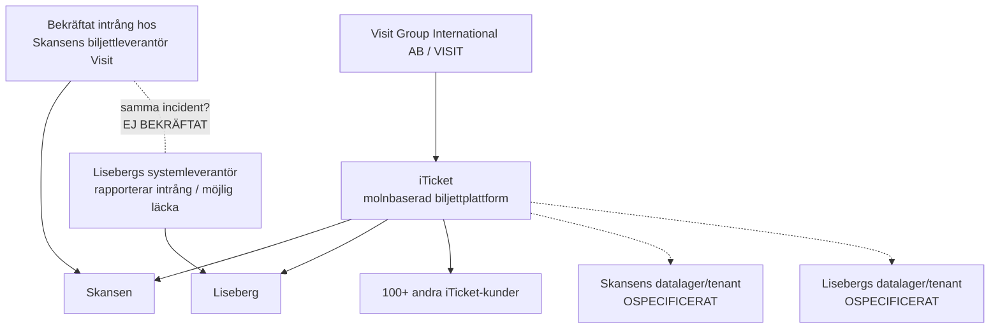
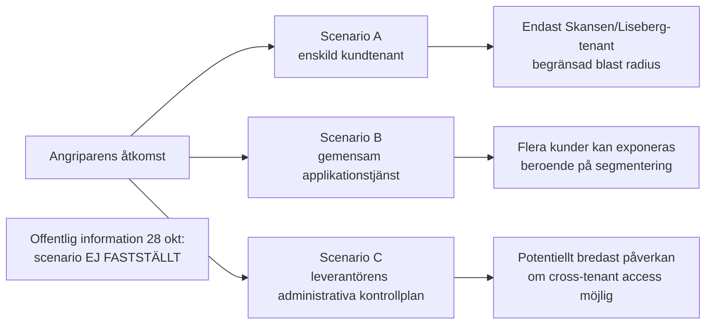
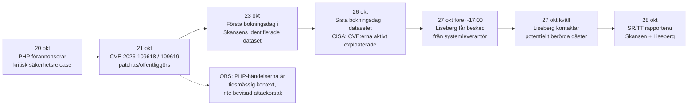

# Händelserapport – Visit Group / iTicket

**Rapportversion:** 1.12 · **Rapportdatum:** 29 oktober 2026

[Arkiverad rapport v1.12](./historik/v1.12/)

---

# Teknisk incidentrapport: dataintrång hos Skansens biljettleverantör, Liseberg och Visit/iTicket

**Rapportdatum:** 29 oktober 2026  
**Version:** 1.12 – fullständig konsoliderad rapport med daterade OSINT-tillägg  
**Tidszon:** Europe/Stockholm  
**Omfattning:** Skansen, Liseberg, Visit Group International AB/VISIT, iTicket samt andra offentligt identifierbara kunder på samma plattform  
**Metod:** passiv OSINT och icke-intrusiv granskning av publika webbresurser. Ingen portskanning, sårbarhetsskanning, inloggning, exploatering, fuzzning eller annan aktiv säkerhetstestning har utförts.

## Nya källbelagda VISIT-kundrelationer – 29 oktober 2026 kl. 09:53 CET (äldre källmaterial)

**Två större svenska hotellgrupper och en fristående hotellreferens har identifierats i VISIT:s och samarbetspartners publicerade material.** Dessa är **nyupptäckta relationer i kundkartläggningen**, inte nya säkerhetsincidenter. VISIT Summit hölls **14–16 september 2026**; övriga källor är publicerade före eller kontrollerade 29 oktober 2026. Inga källor belägger påverkan från intrånget 23–27 oktober.

| Kund / verksamhet | Belagd relation och primärunderlag | Säkerhetsgrad för relation | Incidentkoppling |
|---|---|---|---|
| **ESS Group** (koncern, enligt Guest XP cirka 14 destinationer) | VISIT namnger [ESS Group som kund/partner](https://visit.com/platform) och beskriver [VisBook-användning i ESS:s gästdataarbete](https://visit.com/blog/start-small-then-say-welcome-back). På [VISIT Summit 2026](https://visit.com/summit) beskrevs en kundledd demonstration av VISIT-plattformen hos ESS. | **Mycket hög** för VISIT-koncernrelation och VisBook i dokumenterad ESS-miljö; ej belagt att varje ESS-anläggning använder samma produkt. | **Ingen bekräftad påverkan.** |
| **Ellery Beach House**, Lidingö (ESS Group) | [Guest XP:s kundcase](https://guestxp.io/blog/ellery-beach-house-guest-experience) anger uttryckligen **VisBook PMS och BookVisit** för Ellery. Kundcaset beskriver Guest XP:s integration och är en tredjepartsförstahandskälla. | **Mycket hög** för namngiven anläggning och produkterna. | **Ingen bekräftad påverkan.** |
| **Lotus Hotel Group** (fyra hotell) | [VISIT Summit 2026](https://visit.com/summit) namnger Lotus bland exempel på integrerad gästresa; [HotelTechReport:s VISIT PMS-profil](https://hoteltechreport.com/operations/property-management-systems/visit-pms) namnger **Lotus Hotel Group** som VisBook-referens. [Lotus egen webbplats](https://lotushotelgroup.se/lotus-member/) anger de fyra hotellen: **Arken Hotel & Art Garden Spa**, **Hôtel Eggers**, **Varbergs Stadshotell & Asia Spa**, **Billingehus**. | **Hög** för koncernrelation och VisBook-referens. Koncerntillhörighet är bekräftad, men samma installation på alla fyra hotellen är inte separat verifierad. | **Ingen bekräftad påverkan.** |
| **Vadstena Klosterhotell** | Namnges uttryckligen i [VISIT Summit 2026](https://visit.com/summit) som hotell i demonstration av integrerad gästresa. [Guest XP:s webbplats](https://guestxp.io/) visar hotellet bland sina kunder för en produkt integrerad i VisBook/BookVisit, men bekräftar inte separat vilket VISIT-system hotellet använder. | **Medel–hög** för VISIT-ekosystemrelation; **ej tillräcklig för produkt-/tenantklassning**. | **Ingen bekräftad påverkan.** |

**Avgränsning:** VISIT:s officiella incidentmeddelande den 28 oktober begränsade intrånget till **Citybreak Online** enligt leverantörens egen beskrivning. VisBook- och BookVisit-kundrelationer innebär inte i sig att kundens uppgifter hanterats i den komprometterade Citybreak-miljön. Ingen av ovanstående ska räknas som ett sjätte incidentoffer eller som verifierat exponerad tenant. Namngivna hotell inom koncernerna ska inte dubbelräknas som separata kundavtal utan avtalsbelägg.

**Övrig kontroll 29 oktober:** [Skansen](https://www.skansen.se/dataintrang/) (senast uppdaterad 28 okt 12:20), [Liseberg](https://www.liseberg.se/om-liseberg/bedrageri-och-sakerhet) (27 okt), [Tekniska museet](https://www.tekniskamuseet.se/dataintrang/) (28 okt), [Junibacken](https://www.junibacken.se/uppgifter-om-dataintrang-28-oktober-2026/) (28 okt 10:25) och [STF](https://www.svenskaturistforeningen.se/om-stf/aktuellt/information-om-sakerhetsincident-hos-var-bokningsleverantor/) (28 okt) hade inga nyare verifierade incidentbesked. Riktade sökningar på svenska, norska, danska, engelska och franska efter de kartlagda verksamheterna och ransomware-/dataintrångsrapporter gav inga ytterligare namngivna drabbade kunder, angripare eller incidentspecifika tekniska indikatorer. [VISIT:s statussida](https://status.visitgroup.com/) och dess [Citybreak-säkerhetsmeddelande](https://status.visitgroup.com/issues/6ae1d4a838e2f6f97a391a3e) kunde inte läsas direkt via webbkällan; detta är inte bevis för en driftstörning. [iTickets webbplats](https://www.iticket.com/) och [VISIT:s utvecklardokumentation](https://visit.com/developer-documentation) gav inga nya incidentspecifika uppgifter. Ingen aktiv säkerhetstestning utfördes.

## Nytt källbelagt kundspår – 29 oktober 2026 kl. 07:35 CET (källdatum 26 juni 2026)

**Två tidigare oregistrerade Citybreak-partnerreferenser: Gotland Promotion och Destination Österlen.** I [Sirvoys officiella integrationsdokumentation, *Connect Sirvoy to BookVisit or Citybreak Partners*](https://help.sirvoy.com/setting-up-new-channels/connect-sirvoy-to-bookvisit-or-citybreak-partners), senast uppdaterad **26 juni 2026**, namnges **STF, Gotland Promotion och Destination Österlen** som exempel på **Citybreak (Visitgroup)-partner**. STF är sedan tidigare en känd Visit-relaterad incidentpart; de två andra är nya i denna kartläggning.

| Verksamhet | Belagd relation | Källtyp och säkerhetsgrad | Incidentkoppling |
|---|---|---|---|
| **Gotland Promotion** | Namngiven som Citybreak (Visitgroup)-partner i Sirvoys integrationsdokumentation. | **Hög** för dokumenterad historisk partnerrelation, utifrån namngiven tredjepartsleverantör; aktiv drift per 29 oktober inte oberoende bekräftad. | **Ingen bekräftad påverkan**, ingen exfiltration eller tenantkoppling belagd. |
| **Destination Österlen** | Namngiven som Citybreak (Visitgroup)-partner i samma dokumentation. | **Hög** för dokumenterad historisk partnerrelation; aktuell produktionsstatus ej verifierad. | **Ingen bekräftad påverkan**, ingen exfiltration eller tenantkoppling belagd. |

**Teknisk dokumentation:** Sirvoy beskriver en integrationsväg där en Citybreak-partner kan tillhandahålla ett **BookVisit-ID**, varefter Sirvoys kanalhanterare synkroniserar tillgänglighet, priser och bokningar med BookVisit. Dokumentationen nämner också att bokningar från anslutningen importeras till Sirvoy efter konfigurering. **Detta visar en möjlig dokumenterad integrationskedja mellan Citybreak-partner, BookVisit och Sirvoy, men inte att incidentdata passerat alla dessa komponenter, att någon av dem komprometterats eller att VISIT:s produktavgränsning är felaktig.** En dokumenterad partnerrelation är inte bevis för att partnern berörs av Citybreak-intrånget. [Källa, avsnitt *Connect Sirvoy to BookVisit or Citybreak Partners*](https://help.sirvoy.com/setting-up-new-channels/connect-sirvoy-to-bookvisit-or-citybreak-partners).

**Övrig kontroll:** Direkta kontroller av [Junibackens](https://www.junibacken.se/uppgifter-om-dataintrang-28-oktober-2026/), [Tekniska museets](https://www.tekniskamuseet.se/dataintrang/) och [STF:s](https://www.svenskaturistforeningen.se/om-stf/aktuellt/information-om-sakerhetsincident-hos-var-bokningsleverantor/) incidentmeddelanden visar inga nyare daterade kundbesked än 28 oktober. Riktade sökningar på svenska, norska, danska, engelska och franska gav inga nya verifierade drabbade verksamheter, angreppsmetoder, ransomwarebelägg eller incidentspecifika IoC:er. [VISIT:s statussida](https://status.visitgroup.com/) och [Citybreak-notisen](https://status.visitgroup.com/issues/6ae1d4a838e2f6f97a391a3e) gick inte att läsa direkt via kontrollverktyget; detta är **ingen verifierad driftstörning**. Någon aktiv skanning eller sårbarhetstestning har inte genomförts.

**Samlad klassning:** Två nya **källbelagda Citybreak-partnerreferenser**, inte två nya incidentoffer. Antalet offentligt namngivna verksamheter med incidentbesked är fortsatt **fem**: Skansen, Liseberg, Tekniska museet, STF och Junibacken.

## Väsentligt nytt OSINT-fynd – 29 oktober 2026 kl. 02:26 CET (publicerad 28 oktober)

**Liseberg: 15 000 gäster uppges drabbade av dataläckan.** [Göteborgs-Posten, *15 000 Lisebergsgäster drabbade av dataläcka*](https://www.gp.se/nyheter/goteborg/15-000-lisebergsgaster-drabbade-av-datalacka.eebf20c2-0085-53f5-a9ef-a85bb1000e4e), indexerad som publicerad **28 oktober 2026**, uppger att **15 000 Lisebergsgäster** berörs och att **en obehörig aktör kommit åt namn och kontaktuppgifter genom intrång hos bokningsleverantören Visit**. Tidningens fullständiga artikeltext är åtkomstbegränsad i denna kontroll; uppgifterna är verifierade som **GP:s publicerade rubrik och ingress**, inte genom en oberoende forensisk granskning eller ett nytt primärbesked från Liseberg.

| Påstående | Bevisklass | Säkerhetsgrad |
|---|---|---|
| 15 000 Lisebergsgäster berörs. | **Ny kvantifierad medieuppgift** från Göteborgs-Posten (rubrik). Antalet är inte bekräftat i Lisebergs offentliga säkerhetsmeddelande, senast uppdaterat 27 oktober. | **Hög** för att GP rapporterar detta; **medel–hög** för den exakta omfattningen i avsaknad av tillgänglig primärkälla. |
| En obehörig aktör har fått åtkomst till namn och kontaktuppgifter via Visit. | **Medieuppgift** från GP:s ingress; starkare formulering än Lisebergs egen varning om *möjlig* läcka. | **Hög** för publicerat påstående; tekniskt ej oberoende verifierat. |
| Lisebergs dataläcka är kopplad till leverantören Visit. | **Uttrycklig mediekoppling** i GP:s nya rapportering. Liseberg namnger ännu inte Visit i sin offentliga säkerhetstext. | **Hög** för medieuppgiften, **inte** bevis för samma tekniska angreppsväg som hos Skansen eller för komprometterad iTicket-produkt. |

**Jämförelse utan felaktig summering:** Skansen har tidigare uppgett **cirka 4 800 berörda personer**, medan STF uppgett **cirka 759 berörda bokningar**. Dessa storheter har olika definitioner och ska inte adderas till ett totalt antal unika exponerade personer. Lisebergs 15 000 är en separat medieuppgift, och exakt antal exfiltrerade poster är fortfarande okänt.

**Kontroll av primärkällor och teknik:** [Lisebergs säkerhetssida](https://www.liseberg.se/om-liseberg/bedrageri-och-sakerhet) visar fortfarande uppdatering **27 oktober 2026** och anger en möjlig läcka men inga antal. [Junibacken](https://www.junibacken.se/uppgifter-om-dataintrang-28-oktober-2026/), [Tekniska museet](https://www.tekniskamuseet.se/dataintrang/), [STF](https://www.svenskaturistforeningen.se/om-stf/aktuellt/information-om-sakerhetsincident-hos-var-bokningsleverantor/) och [Skansens engelska informationssida](https://www.skansen.se/en/data-breach/) har inte lämnat ny kvantifierad påverkan i denna kontroll. [iTicket](https://www.iticket.com/) och [VISIT:s API-/utvecklarsida](https://visit.com/developer-documentation) innehåller ingen ny verifierad incidentspecifik rotorsak eller IoC. VISIT:s [statussida](https://status.visitgroup.com/) och tidigare [Citybreak-säkerhetsmeddelande](https://status.visitgroup.com/issues/6ae1d4a838e2f6f97a391a3e) kunde inte återläsas direkt (åtkomst-/DNS-begränsning i kontrollmiljön, inte belägg för driftavbrott). Riktade sökningar på svenska, norska, danska, engelska och franska för övriga kartlagda kunder gav inga nya namngivna bekräftade incidentoffer eller belagda ransomware-/angriparuppgifter.

**Samlad klassning:** **Väsentlig ny medieuppgift om Lisebergs omfattning (15 000) och leverantörskoppling**. Ingen ny kund med bekräftat incidentbesked, ingen verifierad teknisk gemensam rotorsak och ingen oberoende verifierad exfiltrationsvolym. Inga nya kundrelationer behöver läggas till i registret denna gång.

## Nytt verifierat OSINT-fynd – 28 oktober 2026, cirka kl. 21:49 CET

**Femte namngivna verksamheten med ett eget Visit-relaterat incidentbesked: Junibacken, Stockholm.** I [Junibackens officiella säkerhetsmeddelande](https://www.junibacken.se/uppgifter-om-dataintrang-28-oktober-2026/), **senast uppdaterat 28 oktober 2026 kl. 10:25**, bekräftar Junibacken uttryckligen att man fått information om **ett dataintrång hos Visit, leverantören av dess bokningssystem**. Junibackens [startsida](https://www.junibacken.se/) länkar även till samma incidentinformation. Detta är en **nyupptäckt primärkälla i bevakningen**, även om publiceringen skedde tidigare samma dag.

| Ny verifierad uppgift | Klassning | Säkerhetsgrad |
|---|---|---|
| Junibacken namnger **Visit** som sin bokningsleverantör och uppger att Visit utsatts för dataintrång. | **Bekräftad incidentkommunikation hos kund och uttrycklig leverantörskoppling**; inte oberoende tekniskt belägg för exakt komprometterad produkt/tenant. | **Mycket hög** för kundens förstahandsbesked. |
| Junibacken uppger att **berörda personer informerats**. | Bekräftat kundbesked om notifiering; antal personer och exakta uppgiftsfält anges inte. | **Hög** för kundens uppgift. |
| Junibacken uppger att incidenten **anmälts till Integritetsskyddsmyndigheten (IMY)** och att intrånget **polisanmälts**. | Bekräftad uppgift från kunden om gjorda anmälningar; registreringsnummer eller oberoende mottagningsbekräftelser har inte publicerats i den granskade källan. | **Mycket hög** för att Junibacken lämnat beskedet; **ej oberoende verifierat** hos myndigheterna. |
| Junibacken uppger att **Visit blockerat obehörig åtkomst och säkrat berörda tjänster**. | Leverantörens åtgärder återgivna av kunden, inte oberoende tekniskt verifierade. | **Hög** för uppgiften. |
| Enligt Junibacken omfattas **inga kort- eller betalningsuppgifter** och man känner inte till att uppgifterna använts för bedrägerier. | Kundens egen avgränsning; exakt exponerad personuppgiftsmängd och faktisk exfiltration är ännu okända. | **Hög** för uttalandet; faktisk frånvaro av missbruk kan inte styrkas. |

**Bevisgräns:** Junibackens primärkälla bekräftar **Visit-relaterat incidentbesked**, men identifierar inte vilken av VISIT:s interna produkter, databaser eller integrationer som berörs. Den styrker inte att iTicket som produkt har komprometterats, att Junibackens egna system hackats eller att dess data faktiskt exfiltrerats. Junibacken blir därmed **femte namngivna verksamheten med offentligt incidentbesked** efter Skansen, Liseberg, Tekniska museet och STF; Lisebergs exakta gemensamma tekniska orsak är fortsatt inte fastställd.

**Övrig kontroll:** Förnyade sökningar i svenska, norska, danska, engelska och franska källor samt för kartlagda kunder gav ingen ytterligare namngiven incidentbekräftelse, identifierad angripare, ransomwarekoppling, attackvektor eller incidentspecifik IoC. [VISIT:s statussida](https://status.visitgroup.com/) och de två tidigare dokumenterade [Citybreak-](https://status.visitgroup.com/issues/6ae1d4a838e2f6f97a391a3e) och [WebX-meddelandena](https://status.visitgroup.com/issues/6ae0be26cf60a849e36da5b4) kunde **inte återläsas direkt** i denna kontrollmiljö; det är **inte bevis för ett driftavbrott**. Indexerade produkt- och API-uppgifter gav ingen ny incidentspecifik teknisk detalj. Inga aktiva säkerhetstester utfördes.

## Kompletterande OSINT-kontroll – 28 oktober 2026, cirka kl. 20:19 CET

**Ny verifierad kundrelation, men ingen ny verifierad incident:** **Gausta (Norge)** använder enligt [VISIT:s eget kundcase](https://visit.com/success-stories/gausta) leverantörens **All-in-One PMS (VisBook)** och **GetFOOD** för bland annat hotell- och restaurangdrift. Källans ursprungliga publiceringsdatum är inte fastställt; **verifieringsdatum är 28 oktober 2026**. **Säkerhetsgrad: mycket hög för leverantörsrelationen** (förstahandskälla). **Ingen offentlig bekräftelse på att Gausta drabbats av dataintrånget, ingen belagd användning av Citybreak eller iTicket i just detta kundcase och ingen belagd koppling till den rapporterade Citybreak-incidenten.** Gausta ska inte sammanblandas med **Gaustabanen**, som redan förekommer separat i kundkartläggningen.

**Övrig kontroll:** [Skansen](https://www.skansen.se/en/data-breach/) uppdaterade sin engelska incidentinformation kl. **12:20** den 28 oktober men har inte namngivit fler drabbade kunder eller redovisat ny teknisk rotorsak. [Tekniska museet](https://www.tekniskamuseet.se/dataintrang/) och [Liseberg](https://www.liseberg.se/om-liseberg/bedrageri-och-sakerhet/) lämnar ingen ny incidentbekräftelse utöver tidigare dokumenterade besked. Sökningar i svenska, norska, danska, engelska och franska nyhets- och säkerhetskällor gav inga nya belagda intrångsdrabbade verksamheter eller attackerarkopplingar. VISIT:s [statussida](https://status.visitgroup.com/) och dess [säkerhetsmeddelande](https://status.visitgroup.com/issues/6ae1d4a838e2f6f97a391a3e) gick **inte att återläsa direkt** i denna kontrollmiljö; tidigare kontrollerade meddelanden kvarstår som senast belagda, men deras aktuella status kan inte bekräftas för detta klockslag. Ingen aktiv sårbarhetsprovning eller nätverksskanning har utförts.

**Bedömning:** En ny leverantörsrelation har dokumenterats i kundregistret. Ingen ny väsentlig säkerhetsincident är verifierad; inga nya påståenden om drabbade eller exfiltration görs.

## Senaste verifierade uppdatering – 28 oktober 2026 kl. 18:48 CET

**Väsentlig ny primärkälla: VISIT bekräftar själv ett säkerhetsintrång i Citybreak Online.** Två incidentmeddelanden publicerades på [VISIT:s officiella statussida](https://status.visitgroup.com/) den **28 oktober kl. 10:41 och 11:55 CET**. VISIT uppger att obehöriga fått tillgång till en *mycket begränsad mängd bokningsdata* i **Citybreak**, att åtkomsten stoppats, att berörda Citybreak-kunder informerats, att externa säkerhetsexperter utreder och att berörda myndigheter underrättats. Enligt VISIT omfattas **inte kortuppgifter eller inloggnings-/API-uppgifter**, och **andra VISIT-produkter är inte påverkade av just denna incident**. **Mycket hög säkerhet för att leverantören lämnat dessa uppgifter; exfiltrationsvolym och teknisk angreppsväg är inte oberoende verifierade.** [Primärkälla kl. 11:55](https://status.visitgroup.com/issues/6ae1d4a838e2f6f97a391a3e).

**Viktig avgränsning:** Att VISIT avgränsar den publicerade säkerhetsincidenten till **Citybreak** är inte i sig bevis för att Skansens eller Lisebergs iTicket-relaterade kundmiljöer komprometterats. Skansen, Tekniska museet och STF namnger Visit som leverantör för sina incidenter, medan iTicket används som biljettplattform av bland annat Skansen och Liseberg. Offentliga uppgifter räcker ännu inte för att visa vilka bakgrundssystem, integrationer eller tenants som lagrade de berörda bokningarna. Den exakta tekniska kopplingen måste därför hållas **öppen**; VISIT:s produktavgränsning får inte okritiskt likställas med kundernas produktval.

**Separat driftincident med publicerad rotorsak:** VISIT:s [WebX-incidentredogörelse](https://status.visitgroup.com/issues/6ae0be26cf60a849e36da5b4), markerad löst **28 oktober kl. 15:12 CET**, uppger att **delad lagring slutade svara** och gjorde WebX-sidor otillgängliga **27 oktober kl. 15:30–17:55 CET** (cirka 2 timmar 25 minuter). Berörda tjänster anges som Citybreak Web, BookVisit Web och Stays. VISIT känner inte till någon dataförlust från **driftstörningen**. Detta är **inte bevis för koppling till intrånget**. Säkerhetsgrad **mycket hög för leverantörens beskrivning**, oberoende RCA från lagringsleverantören saknas. [Systemstatus kl. 18:48 CET](https://status.visitgroup.com/) anger normal drift, inklusive iTicket och Citybreak.

Inga ytterligare namngivna intrångsdrabbade kunder, publika incidentspecifika IoC:er, identifierad angripare eller bekräftad ransomwarekoppling har hittats. Se daterat tillägg kl. 18:48 för detaljer och källklassning.

## Senaste verifierade uppdatering – 28 oktober 2026 kl. 18:25 CET

**Utökad, källbelagd kartläggning av VISIT:s kundekosystem – inte nya incidentoffer.** VISIT:s [officiella kundcase-översikt](https://visit.com/success-stories) och enskilda kundcase identifierar **16 tidigare ej registrerade kundreferenser**, främst inom VisBook, BookVisit, Godo och Travia, samt **två ytterligare namngivna verksamheter** som uttryckligen använder samma VISIT-PMS inom Mössebergsgruppen. Bland de nya referenserna finns **Lisebergsbyn** (VisBook, ett separat boendeerbjudande under Lisebergs varumärke) och **Jula Hotell** (VisBook och BookVisit, med fem namngivna anläggningar). Se kundregistret och tillägget kl. 18:25 för samtliga källor.

**Säkerhetsgrad: mycket hög för de uttryckligen dokumenterade kund-/produktrelationerna; ingen verifierad incidentkoppling för någon av de nytillagda verksamheterna.** Uppgifterna är befintliga leverantörsreferenser, inte nya avtal den 28 oktober. Inga nya namngivna incidentdrabbade, exfiltrationsbevis, attackvektorer eller incident-IoC:er har hittats. Visit Groups statussida kunde inte kontrolleras direkt i denna körning (åtkomst-/DNS-fel i kontrollmiljön, inte bevis på störning). Skansen, Liseberg, Tekniska museet och STF kvarstår som de fyra offentligt identifierade verksamheterna med incidentbesked.

## Senaste verifierade uppdatering – 28 oktober 2026 kl. 16:53 CET

**Ny fjärde namngiven verksamhet med bekräftad koppling till Visit-intrånget: Svenska Turistföreningen (STF).** I [STF:s eget incidentmeddelande, publicerat 27 oktober och uppdaterat 28 oktober kl. 07:40](https://www.svenskaturistforeningen.se/om-stf/aktuellt/information-om-sakerhetsincident-hos-var-bokningsleverantor/) namnges **Visit** uttryckligen som leverantör för bokning av boenden och aktiviteter. STF bekräftar att **cirka 759 bokningar på svenskaturistforeningen.se**, främst gjorda **23–26 oktober**, **berörs av intrånget**. STF har ännu inte fastställt exakt vilka personuppgifter som hämtats ut och avser kontakta berörda gäster. Betal- och kortuppgifter lagras inte i bokningssystemet, enligt STF. **Säkerhetsgrad: mycket hög** för den direkta leverantörskopplingen och de cirka 759 berörda bokningarna; **exfiltration, exakta datatyper och antal personer ej verifierade**. 759 är **bokningar, inte 759 unika personer**. Detta är ett nyupptäckt belagt fall i bevakningen, trots att kundens uppdatering publicerades tidigare på dagen.

**Ny mediekälla:** [PC för Alla, 28 oktober 2026](https://www.pcforalla.se/article/3271398/dataintrang-visit-information-om-besokare-lackt.html) namnger samma fyra verksamheter: Skansen, Liseberg, Tekniska museet och STF. I en egen kommentar till tidningen säger Tekniska museets PR-ansvarige Calle Ros-Pehrson att berörda gäster informerats. Tidningen preciserar att **namn och e-postadresser** är de aktuella uppgifterna för Tekniska museet; detta är **medieuppgift med hög säkerhetsgrad för att den återges, men inte en forensiskt verifierad uttömmande fältlista**.

**Tidigare verifierat:** Skansen uppger att **4 800 personer** berörs; Tekniska museet bekräftar möjlig exponering via Visit; Liseberg varnar för möjlig läcka i sin leverantörs bokningssystem. **Fyra verksamheter har därmed nu identifierats med uttryckliga incidentbesked**, men deras faktiska dataexfiltration, tenant-scope och gemensamma tekniska rotorsak är fortfarande inte verifierade. Ingen ny incidentkoppling för övriga kartlagda VISIT-/iTicket-kunder har kunnat styrkas.

## Ledningssammanfattning

**NYTT 28 oktober kl. 18:48 CET:** VISIT har på sin officiella [statussida](https://status.visitgroup.com/issues/6ae1d4a838e2f6f97a391a3e) bekräftat obehörig åtkomst till en begränsad mängd **Citybreak-bokningsdata**. Leverantören säger uttryckligen att andra VISIT-produkter inte påverkats av **denna** säkerhetsincident. Det är därmed nu **belagt att VISIT självt medger ett säkerhetsintrång**, men inte att alla iTicket-kunder eller alla VISIT-kunder har drabbats. Sambandet mellan de namngivna kundernas aviseringar och den av VISIT avgränsade Citybreak-incidenten är inte tekniskt dokumenterat. Separat uppger VISIT att ett WebX-avbrott 27 oktober berodde på fel i delad lagring; detta är inte ett belagt cyberangrepp. Se tillägget kl. 18:48.


Det går nu att slå fast en viktigare koppling än att Skansen och Liseberg bara råkar ha samma leverantör: **både Skansen och Liseberg använder iTicket, en molnbaserad biljett- och e-handelsplattform från Visit Group International AB/VISIT**. Skansens nuvarande biljettmiljö på `tickets.skansen.se` identifierar sig uttryckligen som **“Powered by iTicket a part of Visit Group”**. Visit/iTicket listar samtidigt Liseberg som kund, och Lisebergs offentliga upphandling från 2023 tilldelades Visit Group International AB. citeturn20search3turn24view2turn14search1

Det innebär däremot **inte** att Skansen och Liseberg delar samma databas. Jag har inte hittat någon offentlig dokumentation som visar att deras kunddata ligger i samma databas, samma schema, samma tenant eller ens samma driftsinstans. iTicket beskriver lösningen som en gemensam molnplattform, men detta säger ingenting om den interna tenant- eller databas-segmenteringen. Därför är slutsatsen:

> **Samma leverantör: bekräftat. Samma produktplattform, iTicket: bekräftat. Samma databas/tenant: ospecificerat och inte belagt. Samma intrång/root cause: sannolikt möjligt, men ännu inte offentligt bekräftat.**

För **Skansen** är läget starkare än ett rent misstänkt läckage. Skansen har uppgett att obehöriga fått tillgång till information om **4 800 personer** som bokat biljetter mellan **23 och 26 oktober 2026**, efter ett dataintrång hos biljettleverantören Visit. Antalet rapporterades av [SVT/TT 28 oktober kl. 11:20](https://www.svt.se/nyheter/inrikes/misstankt-dataintrang-mot-nojesparker) och är inte oberoende tekniskt verifierat. Både Sveriges Radio och TT återger intrånget. citeturn16search0turn24view5

För **Liseberg** är den officiella formuleringen försiktigare: nöjesparken säger att den fått information om en **möjlig läcka av personuppgifter i bokningssystemet**. Göteborgs-Posten rapporterar att Liseberg fick besked från systemleverantören strax före klockan 17 den 27 oktober om ett dataintrång. Uppgifter som kan ha exponerats är namn, e-postadress, telefonnummer, adress, företagsnamn och besöksdatum. Betal- och kortuppgifter uppges inte omfattas. citeturn24view1turn24view4

**Ingen offentlig källa har per den 28 oktober bekräftat att Skansen- och Lisebergincidenterna har identisk teknisk rotorsak.** TT skriver uttryckligen att kopplingen mellan händelserna är oklar. Det är därför inte korrekt att beskriva detta som en bekräftad plattformsomfattande iTicket-kompromettering. citeturn24view5

Det finns samtidigt en betydande potentiell leverantörsrisk. iTicket visar på sin nuvarande webbplats bland annat Liseberg, Universeum, Stromma Group, Alpinco, Skånes Djurpark, Junibacken, ICEHOTEL, Flåmsbana, Best Arctic och ett antal norska destinationsbolag som kunder eller betrodda varumärken, följt av texten **“+120 more”**. Visit/VISIT som helhet uppger dessutom över 10 000 kunder i 150 länder, men den siffran avser hela Visit-produktportföljen och får inte blandas ihop med iTicket. citeturn24view2turn15search11

**Tekniska museet har bekräftat möjlig personuppgiftsexponering till följd av intrånget hos Visit. Svenska Turistföreningen (STF) har bekräftat cirka 759 berörda bokningar i ett bokningssystem från Visit. Junibacken har nu också ett eget uttryckligt incidentbesked om Visit, inklusive uppgift om anmälan till IMY och polisen.** För Universeum, Skånes Djurpark, Stromma och övriga namngivna kunder saknas fortfarande offentlig bekräftelse om påverkan. Leverantörsrelation är inte detsamma som incidentpåverkan.

Den tekniska attackvektorn är fortfarande **ospecificerad**. Två mycket allvarliga PHP-sårbarheter, **CVE-2026-109618 och CVE-2026-109619**, offentliggjordes och patchades den 21 oktober. PHP-projektet anger att de kan ge oautentiserad remote code execution och CISA lade den 26 oktober till dem i katalogen över aktivt exploaterade sårbarheter. citeturn19search0turn19search1turn19search5 TT har noterat tidsmässigheten, men det finns **ingen offentlig teknisk bevisning för att Visit/iTicket körde en sårbar PHP-version eller att dessa CVE:er användes mot Visit**. Att tillskriva incidenten “PHP2Shell” i nuläget vore spekulation.

### Bedömning i korthet

| Fråga | Bedömning 28 okt 2026 | Säkerhet |
|---|---|---:|
| Är Visit Group International AB Skansens biljettleverantör? | **Ja** | Hög citeturn24view5turn22search11 |
| Använder Skansen iTicket? | **Ja, direkt verifierat på aktuell biljettsajt** | Mycket hög citeturn20search3turn24view0 |
| Använder Liseberg Visit/iTicket? | **Ja** | Hög citeturn14search1turn24view2 |
| Har Skansen utsatts för obehörig åtkomst? | **Ja, enligt Skansens uppgifter till media** | Hög citeturn16search0turn24view5 |
| Har Liseberg möjlig dataexponering? | **Ja** | Mycket hög citeturn24view1turn24view4 |
| Är Lisebergs och Skansens incident samma? | **Ej bekräftat** | — citeturn24view5 |
| Samma produktplattform? | **Ja, iTicket** | Hög citeturn20search3turn24view2 |
| Samma databas/tenant? | **Ospecificerat** | — |
| Är andra Visit-kunder bekräftat påverkade? | **Ja. Tekniska museet bekräftar möjlig exponering och STF bekräftar cirka 759 berörda bokningar genom Visits intrång; Skansen uppger också andra kunder** | Mycket hög för primärbeskeden; exakt dataåtkomst okänd |
| Attackvektor? | **Ospecificerad** | — |
| Publicerade incident-IoC:er? | **Inga funna IP-adresser, hashvärden, domäner eller exploit-paths** | Medelhög |
| PHP2Shell bakom attacken? | **Skansen uppger uttryckligen att det enligt erhållen information saknas koppling** | Hög för Skansens besked; tekniskt underlag ej publicerat |

## Bekräftad händelsebild och osäkerheter

### Skansen

Den offentligt kända händelsebilden är att **Skansens biljettleverantör Visit har drabbats av ett dataintrång och att obehöriga fått tillgång till personuppgifter för personer som bokat biljetter mellan 23 och 26 oktober 2026**. Det framgår både av Sveriges Radios rapportering och av TT:s sammanfattning av Skansens uppgifter till Dagens Nyheter. citeturn16search0turn24view5

Sekundär återgivning av Skansens information anger att bland annat **namn, adress, telefonnummer, e-postadress och uppgifter om biljettköpet** kan omfattas, medan kort- och betalningsinformation inte ska ingå. Skansen har samtidigt varnat för att informationen kan användas i riktade nätfiskeförsök. En primär incidenttext från Skansen har nu hittats (28 oktober kl. 09:20). Den bekräftar namn, telefonnummer, e-postadress och information om genomförda biljettköp som möjliga exponerade uppgifter. Adress nämns i tidigare medierapportering men inte i Skansens publicerade uppräkning; detta är ingen uttrycklig dementi av att adress kan ha berörts. Se tillägget för källhänvisning. citeturn15search3turn16search0

Viktigt är också vad datumintervallet **inte** bevisar. “Bokningar mellan 23 och 26 oktober” är en beskrivning av de poster som identifierats som exponerade. Det behöver inte vara angriparens initiala intrångstid, persistence-period eller exakta exfiltrationstid. Ingen sådan teknisk tidslinje har offentliggjorts.

### Liseberg

Lisebergs egen säkerhetssida, uppdaterad **27 oktober 2026**, säger:

> “Vi har fått uppgifter om en möjlig läcka av personuppgifter i vårt bokningssystem.”

Liseberg uppger samtidigt uttryckligen att betal- och kortuppgifter inte omfattas och att man vid publiceringstillfället inte hade uppgifter om att informationen använts i bedrägerisyfte. citeturn24view1

Göteborgs-Posten återger det meddelande som skickades till berörda gäster. Där anges följande möjliga exponerade fält: **namn, e-postadress, telefonnummer, adress, företagsnamn och besöksdatum**. Lisebergs kommunikationschef Clara Rosendahl uppgav samtidigt att Liseberg fick information från systemleverantören **strax före klockan 17 den 27 oktober**, att åtgärder vidtagits tillsammans med leverantören och att omfattningen fortfarande utreddes. Antalet berörda var ännu okänt **vid det dåvarande uttalandet den 27 oktober**; se ny medieuppgift om 15 000 ovan. citeturn24view4

Detta ger en intressant tidsmässig korrelation med Skansen, men korrelation är inte samma sak som teknisk attribution. TT uttryckte den 28 oktober fortfarande att det var **oklart om incidenterna hade någon koppling till varandra**. citeturn24view5

### Bekräftat kontra obekräftat

| Påstående | Status | Underlag |
|---|---|---|
| Visit har haft ett dataintrång som berör Skansen | **Bekräftat genom Skansens uppgifter** | Skansen via DN/TT/SR. citeturn16search0turn24view5 |
| Skansenposter från 23–26 oktober har varit åtkomliga för obehöriga | **Bekräftat** | Skansen via DN/TT/SR. citeturn16search0turn24view5 |
| Lisebergs bokningssystem kan ha läckt personuppgifter | **Bekräftat som möjlig exponering** | Lisebergs egen webbplats. citeturn24view1 |
| Lisebergs systemleverantör rapporterade ett intrång den 27 oktober | **Bekräftat genom uttalande från Liseberg till GP** | citeturn24view4 |
| Liseberg och Skansen använder Visit/iTicket | **Bekräftat** | Upphandling, iTicket och Skansens biljettmiljö. citeturn14search1turn20search3turn24view2 |
| Det är exakt samma intrång | **Obekräftat** | TT säger att kopplingen är oklar. Skansens nya FAQ säger att andra Visit-kunder påverkats, men namnger dem inte. [Skansen](https://www.skansen.se/dataintrang/). citeturn24view5 |
| De delar databas | **Obekräftat / ingen offentlig information** | Ingen sådan arkitekturdokumentation hittad. |
| Angriparen kom in via PHP2Shell | **Skansen förnekar koppling enligt den information de fått** | [Skansens primär-FAQ 28 oktober](https://www.skansen.se/dataintrang/); ingen oberoende teknisk redogörelse publicerad. |
| Kortdata har stulits | **Motsägs av publicerad information** | Liseberg säger uttryckligen nej; samma uppgift rapporteras för Skansen. citeturn24view1turn15search3 |
| Alla iTicket-kunder är drabbade | **Ingen beläggning** | Skansen bekräftar påverkan hos andra Visit-kunder utan att namnge dem; detta ger inte stöd för att alla iTicket-kunder påverkats. [Skansen](https://www.skansen.se/dataintrang/). |

Det finns även en **separat Lisebergincident från oktober 2024** i sökresultaten. Den berörde bland annat personuppgifter kopplade till Grand Curiosa Hotel. Den ska inte sammanblandas med den aktuella incidenten 2026 utan teknisk bevisning som binder händelserna samman. citeturn3search1turn3search2

Följande är därför den mest försvarbara nulägesbilden:



Diagrammet visar medvetet separata datalager som **okända komponenter**, inte som ett påstående om att separata databaser faktiskt används.

## Leverantör, systemarkitektur och kundkrets

### Visit Group International AB och iTicket

Den juridiska leverantör som återkommer i de svenska upphandlingarna är **Visit Group International AB, organisationsnummer 556559-7423**. Bolaget har under 2026 gått mot varumärket **VISIT**, medan iTicket fortsätter som produktnamn för biljett- och upplevelseplattformen. citeturn22search6turn15search11

iTicket beskriver sin lösning som en **sammanhängande molnbaserad plattform** för bland annat e-handel, biljetter, POS, självservice, realtidslager, paket med boende och externa distributionskanaler. Plattformen kan integrera externa leverantörer genom API och stöder betalningsleverantörer som Nets, Adyen, Klarna och Swedbank Pay. Detta beskriver produktens kapacitet; det betyder inte att alla kunder använder samma konfiguration eller samma betalningsleverantör. citeturn24view2turn22search22

Det är särskilt viktigt i incidentanalysen. Att iTicket är en “core platform” och molntjänst kan innebära gemensamma applikationskomponenter, men följande lager kan fortfarande vara separerade:

```text
gemensam applikationskod
        │
        ├── tenant A / Skansen
        │      └── databas/schema A ?
        │
        ├── tenant B / Liseberg
        │      └── databas/schema B ?
        │
        └── tenant C / annan kund
               └── databas/schema C ?
```

Frågetecknen är avgörande. **Visit har inte offentligt beskrivit iTickets tenant- eller databasarkitektur på en nivå som gör det möjligt att avgöra om Skansen och Liseberg delar fysisk databas, logisk databas, schema, kluster eller endast applikationsplattform.**

### Offentliga kontrakt

| Organisation | Leverantör | System/upphandling | Offentligt känt kontraktsvärde | Datum | Incidentstatus |
|---|---|---|---:|---|---|
| **Skansen** | Visit Group International AB | Ticketing / iTicket | **27,6 MSEK** | Tilldelning 23 maj 2025; TED-publicering 27 juni 2025; uppgivet avtal till 31 maj 2029 | **Bekräftad obehörig åtkomst till kunduppgifter**. citeturn22search11turn24view5 |
| **Liseberg AB** | Visit Group International AB | Ticketing / iTicket | **74 MSEK** enligt tilldelningsdata | Kontrakt 13 januari 2023 | **Möjlig personuppgiftsläcka; intrång utreds**. citeturn14search1turn24view4 |
| **Borås Djurpark & Camping AB** | Visit Group International AB | Biljettsystem | Ej fastställt i det material som granskats | Tilldelning 28 september 2026 | **Ingen offentlig bekräftelse på påverkan**. citeturn22search6 |

Lisebergs 2023-projekt beskrevs som en bred digital lösning som omfattade bland annat onlineförsäljning, kassor/POS, kanalhantering och säsongskort, och iTicket lanserades som den valda plattformen. citeturn6view1turn14search0

Skansen är ännu tydligare att verifiera i dag: den publika kundvagnen på `tickets.skansen.se` är indexerad som **Skansen Online Varukorg** och anger i sökresultatet **“Powered by iTicket a part of Visit Group”**. citeturn20search3

### Offentligt identifierbara iTicket-kunder

En bokstavligt fullständig kundförteckning kan inte tas fram från öppna källor eftersom iTicket inte publicerar sitt kompletta kundregister. Den nuvarande iTicket-sidan visar **18 namngivna/logotypmärkta varumärken och därefter “+120 more”**. Den offentliga listan som går att verifiera från sidan är:

| Offentligt visat namn | Typ av belägg |
|---|---|
| Liseberg | iTicket “Trusted by leading brands” + svensk upphandling |
| Alpinco | iTicket kundlogotyp och kundcitat |
| Brim | iTicket kundlogotyp; exakt juridiskt bolagsnamn anges inte i den granskade sidan |
| Best Arctic | iTicket kundlogotyp och success story |
| The Fjords | iTicket kundlogotyp och success story |
| Norway's Best | iTicket kundlogotyp |
| Geilo | iTicket kundlogotyp; exakt juridisk entitet ej specificerad |
| Fjellheisen | iTicket kundlogotyp |
| Flåmsbana | iTicket kundlogotyp |
| Stromma Group | iTicket kundlogotyp och success story |
| Historie | Logotypetikett på iTicket; juridisk entitet oklar i det granskade materialet |
| ICEHOTEL | iTicket kundlogotyp |
| Junibacken | iTicket kundlogotyp |
| Rødne | iTicket kundlogotyp |
| Skans | Logotypetikett enligt sidan; exakt entitet ej säkerställd |
| Skånes Djurpark | iTicket kundlogotyp; även Lund Gruppen-kundcase |
| Universeum | iTicket kundlogotyp och success story |
| Voss | iTicket kundlogotyp; exakt entitet ej specificerad |

Samtliga namn ovan återfinns i iTickets nuvarande kundsektion. citeturn24view2

Därutöver visar iTickets egna kundcase **Lund Gruppen**, vars lösning omfattar **Kongeparken i Norge och Skånes Djurpark i Sverige**, samt **Lofsdalen**, **O'Gliss Park/Oceano Loisirs**, Stromma, Best Arctic, The Fjords och Universeum. citeturn24view3turn22search19turn22search7

**Skansen** ska läggas till denna OSINT-lista eftersom Skansens egen aktuella biljettmiljö identifierar iTicket som teknisk plattform. **Borås Djurpark** ska däremot i nuläget klassas som “kontrakterad Visit-kund”; tilldelningen i september 2026 visar leverantörsrelationen men bevisar inte att produktionsmigreringen till samma iTicket-miljö var färdig när intrånget skedde. citeturn20search3turn22search6

Visit/VISIT uppger över **10 000 kunder i 150+ länder**, men detta omfattar den bredare portföljen med PMS, booking engine, channel manager, ticketing och andra produkter. Den siffran är alltså **inte antalet iTicket-kunder**. citeturn15search11

### Vilka andra kunder kan vara drabbade?

Den tekniskt korrekta formuleringen är **“potentiellt berörda tills tenant- och incidentomfattningen är känd”**, inte “drabbade”.

För en gemensam SaaS-plattform finns åtminstone tre principiellt olika scenarier:



Det finns ännu inget offentliggjort material som placerar intrånget i scenario A, B eller C. **Tekniska museet har nu bekräftat egen möjlig exponering via Visit**, men det avgör inte vilket av scenarierna som inträffat. Det går **inte** att dra slutsatsen att Universeum, Skånes Djurpark, Stromma eller andra iTicket-kunder har exponerats enbart på grund av deras leverantörsrelation. **Junibacken har dock därefter publicerat ett eget incidentbesked om Visit, verifierat i bevakningen 28 oktober kl. 21:49; se det senaste daterade tillägget.**

## Passiv teknisk inspektion av publika ytor

### Observerad webbarkitektur

Den passiva inspektionen ger ändå flera användbara arkitektursignaler.

| Yta | Observation 28 okt 2026 | Vad den faktiskt bevisar |
|---|---|---|
| `tickets.skansen.se` | Aktuell Skansen-kundvagn; i sökindexet **“Powered by iTicket a part of Visit Group”** | Skansens publika ticketing använder iTicket. citeturn20search3turn24view0 |
| `www.skansen.se` | Separat innehålls-/marknadssajt med länkar mot biljettflödet | Frontsajt och biljettapplikation är separata publika ytor. citeturn24view0 |
| `www.liseberg.se` | Incidentbanner i aktuell HTML; Google Tag Manager-iframe syns i det parserade dokumentet | Säkerhetsmeddelandet är live; tredjepartsresurs från Google Tag Manager förekommer. citeturn24view1 |
| `boka.liseberg.se` | Lisebergs webbplats länkar dit för hotellbokning | Separat bokningssubdomän används. Detta bevisar inte ensamt att just den hosten är iTicket. citeturn24view1 |
| `hotel.liseberg.se` | Länkas för rabatt-/företagskod och presentkort | Ytterligare separat Liseberg-bokningsyta. citeturn24view1 |
| `iticket.com` | Plattformen beskriver e-handel, POS, realtidslager, paket, API-kopplingar och betalningsleverantörer | Bekräftar produktens funktionella attackyta, inte vilka komponenter som komprometterats. citeturn24view2 |

Lisebergs aktuella HTML-extraktion visar bland annat följande externa element:

```text
iframe -> www.googletagmanager.com

Grand Curiosa Hotel:
  boka rum -> boka.liseberg.se

företags-/rabattkod:
  -> hotel.liseberg.se
```

Detta är **inte** en indikator på intrång. Google Tag Manager är en normal tredjepartskomponent. Inga observerade script- eller domänreferenser i det parserade materialet kan i sig klassas som skadliga. citeturn24view1

### Ett intressant Visit-infrastrukturspår hos Universeum

Ett äldre publikt, indexerat svar från Universeums bokningsmiljö på `book.universeum.se` exponerade följande build-/backendinformation:

```text
Build: 4/14/2026 2:02:24 PM
Host: CBONLINEBOTS01
DB: o3.cbguide-9177.cbischannel-42105.v1
cbraven01.visitgroup.com:8080
Controller: Todo
Action: showdetails
```

Detta material kopplar Universeums bokningsyta till en `visitgroup.com`-host och visar en explicit `DB:`-identifierare i det publikt indexerade svaret. citeturn22search20

Det är ett användbart OSINT-fynd, men ska **inte** övertolkas. Det gäller ett Universeum/Visit-flöde och bevisar varken att Universeum använder samma databas som Skansen/Liseberg eller att just denna komponent är del av intrånget. Tvärtom illustrerar den separata DB-identifikationen varför det inte går att anta att “samma SaaS” betyder “samma databas”.

### HTTP-status och driftobservationer

Vid passiv öppning av en Liseberg-bokningsadress svarade `boka.liseberg.se` vid ett tillfälle med **HTTP 429 Too Many Requests**. Det är förenligt med rate limiting eller bot-skydd och är **inte en IoC och inte ett bevis på attacker eller överbelastning**. En crawler kan själv utlösa sådan begränsning.

Det är viktigt att skilja detta från Lisebergs rapporterade incident. Lisebergs egen säkerhetssida säger att personuppgifter kan ha läckt, men ger inga tekniska loggar eller HTTP-fel som skulle kunna kopplas till angriparen. citeturn24view1

### DNS, CNAME, headers, JavaScript, cookies och nätverkstrafik

Här finns en viktig metodbegränsning. Den lokala analysmiljön saknade fungerande extern DNS-upplösning. Passiva `curl`-försök stoppades därför **innan någon HTTP-anslutning kunde etableras**:

```text
### tickets.skansen.se
### www.skansen.se
### liseberg.se
### boka.liseberg.se
### iticket.com

curl: (6) Could not resolve host: tickets.skansen.se
curl: (6) Could not resolve host: www.liseberg.se
```

Tillgängliga lokala verktyg kontrollerades:

```text
curl       /usr/local/bin/curl
wget       /usr/bin/wget
chromium   /usr/bin/chromium
dig        NOT_FOUND
nslookup   NOT_FOUND
openssl    /usr/bin/openssl
```

Det innebär att jag **inte tillskriver några A-, AAAA- eller CNAME-poster, IP-adresser, TLS-parametrar eller HTTP-säkerhetsheaders till dessa system utan verifiering**. Att fylla i sådana värden från antaganden skulle minska rapportens tillförlitlighet.

Status för de efterfrågade tekniska artefakterna blir därför:

| Artefakt | Resultat |
|---|---|
| HTML | **Delvis verifierad** genom passiva webbfetchar. |
| Publika subdomäner | **Verifierade** genom aktuella länkar/index: bl.a. `tickets.skansen.se`, `boka.liseberg.se`, `hotel.liseberg.se`. citeturn24view0turn24view1 |
| Tredjepartsscript/iframe | **Google Tag Manager verifierat på Liseberg**. citeturn24view1 |
| JavaScript-bundles | Inte tillräckligt exponerade i tillgänglig parser för säker inventering. |
| API-endpoints | Ingen incidentrelevant publik endpoint kunde verifieras. iTicket stöder API-integrationer generellt. citeturn22search22 |
| Cookies | Cookiefunktioner finns, men exakta cookie-namn/värden kunde inte tillförlitligt enumereras. |
| Network/HAR | Ingen fullständig browser-HAR kunde samlas på grund av nätverksbegränsningen. |
| HTTP response headers | Inte verifierade från egen shell-session. |
| DNS A/AAAA/CNAME | Inte verifierade från egen resolver. |
| TLS-certifikat | Inte verifierade från egen `openssl`-session. |
| Intrångsspecifika IP-adresser/domäner/hashar | **Inga publikt publicerade hittade.** |

Det är en viktig skillnad mellan en **teknisk OSINT-rapport** och en riktig DFIR-utredning. För att fastställa attackvägen krävs normalt leverantörens reverse-proxy-/WAF-loggar, applikationsloggar, IAM-auditloggar, databasaudit, EDR-data, cloud control-plane-loggar och eventuella snapshots. Inget av detta är offentligt tillgängligt i nuläget.

## Attackanalys, tidslinje och risk

### Vad vet vi om attackvektorn?

Den offentliga incidentinformationen anger **dataintrång**, men inte:

| Teknisk fråga | Offentlig status |
|---|---|
| Initial access | **Ospecificerad** |
| Exploaterad CVE | **Ospecificerad** |
| Stulna credentials | **Ospecificerat** |
| MFA-bypass | **Ospecificerat** |
| SQL injection | **Ingen uppgift** |
| RCE | **Ingen uppgift för Visitincidenten** |
| Supply-chain attack | **Ingen uppgift** |
| Komprometterat admin-konto | **Ingen uppgift** |
| API-token/API-nyckel | **Ingen uppgift** |
| Webshell | **Ingen uppgift** |
| Lateral movement | **Ingen uppgift** |
| Persistence | **Ingen uppgift** |
| Exfiltrationsmetod | **Ingen uppgift** |
| Exfiltrerad datamängd | **Okänd** |
| Antal drabbade personer | **Okänt, åtminstone offentligt för Liseberg**. citeturn24view4 |
| Angripargrupp | **Ingen attribution** |
| Ransomware | **Ingen offentlig indikation** |
| Utpressning/darknet-publicering | **Ingen offentlig indikation hittad** |

### PHP2Shell-hypotesen

Tidsmässigheten är anmärkningsvärd men otillräcklig för attribution.

PHP:s säkerhetsteam förannonserade den **20 oktober 2026** två kritiska PHP-sårbarheter. Den **21 oktober** kom säkerhetsuppdateringar för **CVE-2026-109618** och **CVE-2026-109619**, vilka enligt PHP kan möjliggöra oautentiserad remote code execution. PHP-projektet skrev att fullständiga alternativa mitigeringar saknades och rekommenderade uppdatering. citeturn19search4turn19search0

CISA uppdaterade därefter sin information och den **26 oktober** fördes båda sårbarheterna in i Known Exploited Vulnerabilities-katalogen, vilket innebär att faktisk exploatering i det vilda konstaterats. citeturn19search1turn19search5turn19search13

TT noterade den 28 oktober att rapporterna om Skansen och Liseberg kom kort efter att PHP-brister blivit kända. citeturn24view5

Men tre länkar saknas helt:

**För det första:** inget granskat tekniskt material visar att den relevanta Visit/iTicket-backenden körde en sårbar PHP-version.

**För det andra:** inga Visit-specifika loggar, exploit-paths eller IoC:er har offentliggjorts som matchar CVE-2026-109618 eller CVE-2026-109619.

**För det tredje:** ingen av Visit, Skansen eller Liseberg har offentligt tillskrivit incidenten PHP-sårbarheterna.

**Uppdatering 28 oktober kl. 09:20:** Skansen säger uttryckligen att det enligt den information de fått **inte finns någon koppling** mellan Visit-intrånget och de uppmärksammade PHP-sårbarheterna. Detta är den starkaste publicerade incidentnära uppgiften och väger tyngre än den tidigare tidsmässiga hypotesen. Inga forensiska detaljer har offentliggjorts. [Skansens incident-FAQ](https://www.skansen.se/dataintrang/).

### Tidslinje



PHP-tidslinjen stöds av PHP och CISA; Skansen- och Lisebergdatumen stöds av Sveriges Radio, Lisebergs egen information och GP. citeturn19search4turn19search5turn16search0turn24view4

### Exponerade uppgifter och risk per organisation

| Organisation | Uppgifter | Exponeringsstatus | Kort/betaldata | Incidentrelaterad risk |
|---|---|---|---|---|
| **Skansen** | Namn, adress, telefon, e-post och biljettköpsinformation enligt rapporteringen | **Obehörig åtkomst uppges ha skett**, bokningar 23–26 okt | Uppges inte omfattas | **Hög** – kontaktdata + verklig köp-/besökskontext ger bra material för övertygande phishing. citeturn16search0turn15search3 |
| **Liseberg** | Namn, e-post, telefon, adress, företagsnamn, besöksdatum | **Möjlig läcka; utreds** | Liseberg säger uttryckligen nej | **Medel–hög/Hög vid bekräftad exfiltration**. citeturn24view1turn24view4 |
| **Svenska Turistföreningen (STF)** | Exakta datafält ännu ej kända | **Cirka 759 bokningar bekräftat berörda, främst 23–26 okt; exfiltration ej klarlagd** | STF säger att kortdata lagras separat | **Okänd–hög** beroende på faktiskt hämtade data. [STF 28 okt 07:40](https://www.svenskaturistforeningen.se/om-stf/aktuellt/information-om-sakerhetsincident-hos-var-bokningsleverantor/) |
| **Tekniska museet** | Namn och e-post enligt PC för Allas 28-okt-artikel; primärkälla specificerar inte en uttömmande fältlista | **Möjlig exponering via Visit; berörda informerades 28 okt** | Museet säger nej | **Medel–hög** beroende på faktiskt utfall. [Museet](https://www.tekniskamuseet.se/dataintrang/), [PC för Alla](https://www.pcforalla.se/article/3271398/dataintrang-visit-information-om-besokare-lackt.html) |
| **Universeum** | Ingen aktuell incidentdata offentlig | Ingen bekräftad påverkan funnen | Okänt | **Okänd**, inte “låg”; samma plattform är inte tillräckligt för att bedöma incidentomfattning. citeturn24view2turn24view3 |
| **Skånes Djurpark / Lund Gruppen** | Ingen aktuell incidentdata offentlig | Ingen bekräftad påverkan funnen | Okänt | **Okänd**. citeturn22search19 |
| **Stromma Group** | Ingen aktuell incidentdata offentlig | Ingen bekräftad påverkan funnen | Okänt | **Okänd**. citeturn22search0 |
| **Junibacken** | Exakta berörda personuppgifter och antal ej publicerade | **Visit-intrång uttryckligen bekräftat i Junibackens eget meddelande 28 okt kl. 10:25; berörda uppges informerade; IMY- och polisanmälan uppges gjorda** | Uppges inte omfattas | **Okänd–hög** beroende på faktiska exponerade data. [Junibacken, 28 okt](https://www.junibacken.se/uppgifter-om-dataintrang-28-oktober-2026/) |
| **Borås Djurpark** | Ingen incidentdata offentlig | Ny Visit-kontraktering, produktionsstatus oklar | Okänt | **Okänd**. citeturn22search6 |
| **Övriga iTicket-kunder** | Okänt | Ingen generell plattformsincident offentliggjord i granskat material | Okänt | **Ej bedömbar utan leverantörens tenant-scope**. citeturn24view2 |

“Risk” i tabellen är en kvalitativ integritets-/bedrägeribedömning, inte ett CVSS-värde. Kontaktuppgifter kombinerade med korrekta besöksdatum och köpdetaljer gör det exempelvis möjligt att formulera mycket trovärdiga meddelanden i stil med “problem med din Skansenbokning den 25 oktober” eller “återbetalning för ditt Lisebergsbesök”. Det är också därför både Skansen och Liseberg varnar för nätfiske. citeturn16search0turn24view1

### Incident-IoC:er

Några klassiska DFIR-IoC:er för själva Visitincidenten har inte kunnat identifieras i de offentliga källorna:

| IoC-typ | Offentlig information |
|---|---|
| Angripar-IP | Ej publicerad |
| C2-domän | Ej publicerad |
| Skadlig domän | Ej publicerad |
| Hash / malware sample | Ej publicerad |
| Webshell-filnamn | Ej publicerat |
| Angripar-user-agent | Ej publicerad |
| Exploit-URI | Ej publicerad |
| Komprometterat konto | Ej publicerat |
| Tid för initial compromise | Ej publicerad |
| Exfiltrations-IP | Ej publicerad |
| Angripargrupp | Ej attribuerad |

Det närmaste användarna har till en praktisk “indicator” är därför **social**, inte teknisk: ovanliga mejl eller sms som känner till ett verkligt Skansen-/Lisebergbesök och därefter ber mottagaren klicka på en länk, lämna uppgifter eller genomföra betalning. Lisebergs officiella råd är specifikt att vara försiktig med sådana meddelanden. citeturn24view1

## Metod, exakta sökningar och källvärdering

Undersökningen har hållits helt på **passiv OSINT-nivå**. Informationsinhämtningen bestod av sökmotorindex, öppning av publika webbsidor, Visit/iTickets egna produkt- och kundsidor, svenska upphandlingsdata, officiella säkerhetsmeddelanden, PHP:s egen säkerhetsinformation, CISA:s vulnerability-information samt etablerade svenska nyhetsmedier. Ingen autentisering, scanning eller säkerhetsprobning mot Visit eller kundernas system utfördes.

### Exekvererade shell-kommandon

Följande passiva kommandon kördes lokalt:

```bash
for h in tickets.skansen.se www.skansen.se liseberg.se boka.liseberg.se iticket.com; do
    echo "### $h"
    getent ahosts "$h" | head -5 || true
done

curl -sSIL --max-time 10 https://tickets.skansen.se/sv/varukorg
curl -sSIL --max-time 10 https://www.liseberg.se/

for c in curl wget chromium dig nslookup openssl; do
    printf '%-10s ' "$c"
    command -v "$c" || echo 'NOT_FOUND'
done
```

DNS-upplösningen fungerade inte i körmiljön; `curl` gav:

```text
curl: (6) Could not resolve host: tickets.skansen.se
curl: (6) Could not resolve host: www.liseberg.se
```

Därför användes inga lokalt framtagna IP-, DNS-, CNAME-, TLS- eller headeruppgifter i slutsatserna.

### Exakta OSINT-sökfrågor

Följande söksträngar kördes under undersökningen, bland annat för att försöka fånga både svenska incidentmeddelanden, leverantörskopplingar, upphandlingsdata, plattformsreferenser och möjliga andra drabbade organisationer:

```text
site:skansen.se dataintrång biljettleverantör oktober 2026 Visit Group
site:liseberg.se dataintrång bokningssystem oktober 2026 Visit Group
Visit Group dataintrång oktober 2026 Skansen Liseberg
Visit Group cyberattack breach October 2026 ticketing Sweden

Skansen kunduppgifter läckt biljettleverantör 27 oktober 2026
Liseberg kunduppgifter läckt bokningsleverantör 27 oktober 2026
Skansen Liseberg personuppgifter läcka 2026 Visit Group
"Visit Group" "Skansen" "Liseberg" 2026

site:skansen.se "23 och 26 oktober" Visit personuppgifter
site:skansen.se "Visit" "personuppgifter" "oktober" 2026
site:liseberg.se "personuppgifter" "27 oktober 2026" bokning
site:liseberg.se "dataintrång" "2026" Visit Group

"Liseberg" "Visit" "23" "26 oktober" 2026 personuppgifter
"Liseberg" "Visit Group" "personuppgifter" 2026
"Liseberg" "namn" "e-post" "telefonnummer" "postadress" 2026 läcka
"Skansen" "namn" "e-post" "telefonnummer" "Visit" 2026

site:visitgroup.com Liseberg Visit Group ticketing
site:visitgroup.com Skansen Visit Group ticketing
site:visitgroup.com "Liseberg" "Skansen"
site:visitgroup.com customers attractions ticketing Sweden Visit Group

Liseberg Visit Group upphandling biljettsystem 74 miljoner 2023
Skansen Visit Group upphandling biljettsystem 2025
site:mercell.com Liseberg Visit Group ticket system 2023
site:opic.com Visit Group Skansen biljettsystem

site:visitgroup.com security incident October 27 2026 Visit Group data breach
site:status.visitgroup.com incident October 2026 iTicket
site:visitgroup.com "October 27, 2026" security
Visit Group incident 27 October 2026 iTicket

"Skansen" iTicket Visit Group
site:visitgroup.com Skansen iTicket
site:linkedin.com Visit Group Skansen iTicket 2025
"Stiftelsen Skansen" "Visit Group"

"Powered by iTicket a part of Visit Group"
"iTicket by VISIT" attraction Sweden
"iTicket" "Visit Group" park museum Sweden
"iTicket" "Visit Group" customer

site:ted.europa.eu Liseberg ticket system Visit Group 2023
site:ted.europa.eu Skansen ticketing Visit Group 2025
site:upphandling24.se Liseberg Visit Group biljettsystem 2023
site:mercell.com "Visit Group" "Liseberg"

"digital helhetslösning" Liseberg Visit Group upphandling
"iTicket" Liseberg upphandling Visit Group avtal
"Visit Group International AB" Liseberg avtal
"Visit Group International AB" Skansen avtal

"Visit Group" dataintrång Liseberg Skansen 28 oktober 2026
"Visit Group" säkerhetsincident oktober 2026 iTicket
"bokningssystem" "27 oktober 2026" Liseberg läcka
"Skansen" dataintrång "27 oktober 2026" Visit

site:gp.se Liseberg dataläcka 27 oktober 2026 bokningssystem
site:svt.se Skansen Liseberg dataintrång 27 oktober 2026
site:sverigesradio.se Skansen Liseberg dataintrång 2026
site:aftonbladet.se Skansen Liseberg dataintrång 27 oktober 2026

"möjlig läcka" "bokningssystem" 27 oktober 2026 nöjespark
"personuppgifter kan ha läckt" "Visit Group" 2026
"dataintrång" "iTicket" 2026 Sverige
"personuppgifter" "iTicket" "27 oktober" 2026

site:aftonbladet.se/nyheter "Misstänkt dataintrång mot nöjesparker"
site:gp.se/nyheter/sverige "Misstänkt dataintrång mot nöjesparker"
"Misstänkt dataintrång mot nöjesparker"
"Både Liseberg och Skansen" "bokningssystem"

site:php.net security October 2026 vulnerability PHP October 2026
site:cisa.gov PHP vulnerability October 2026
PHP vulnerabilities October 2026 sites shut down last week Sweden October 2026
"PHP" "October" 2026 vulnerability critical CVE

site:skansen.se "personuppgifter" "26 oktober" 2026
site:skansen.se "dataintrång" 2026 biljett
site:skansen.se "nätfiske" biljett 2026
site:skansen.se "Visit" biljett personuppgifter

site:gp.se Liseberg "företagsnamn" "besöksdatum" 2026
site:dn.se Skansen "23 och 26 oktober" namn adress telefonnummer e-post 2026
"företagsnamn" "besöksdatum" Liseberg läcka
"23 och 26 oktober" Skansen dataintrång Visit

site:iticket.com "customers such as" iTicket Liseberg Universeum Stromma Flåmsbana Alpinco
site:visit.com iTicket customer "Skansen" Universeum Stromma Lund Gruppen
"Visit Group International AB" "Skansen" upphandling 2025 biljettsystem
"Visit Group International AB" iTicket kund Sverige Universeum Skansen Liseberg

"tickets.skansen.se" CNAME DNS
"boka.liseberg.se" CNAME DNS
site:liseberg.se iTicket Visit Group biljetter boka
site:iticket.com Liseberg ticket booking domain liseberg
```

### Källvärdering och slutlig teknisk bedömning

De starkaste källorna för **Lisebergincidenten** är Lisebergs egen säkerhetssida och Lisebergs uttalanden till Göteborgs-Posten. Lisebergs officiella webbplats bekräftar den möjliga personuppgiftsläckan och frånvaron av betal-/kortuppgifter, medan GP har den detaljerade fältlistan och tidpunkten då leverantören underrättade Liseberg. citeturn24view1turn24view4

För **Skansen** är Sveriges Radio och TT de starkaste direkt tillgängliga källorna i granskningen; båda återger Skansens uppgifter om intrång hos Visit och kundposterna från 23–26 oktober. Skansens aktuella biljettwebb ger dessutom oberoende teknisk bekräftelse på att iTicket/Visit är plattformen. citeturn16search0turn24view5turn20search3

För **leverantörs- och systemkopplingen** väger iTickets egen aktuella webbplats, Skansens aktuella biljettmiljö och upphandlingsinformationen tyngst. Upphandlingsregistren bygger på TED och offentlig upphandlingsdata, men är i rapporten behandlade som bearbetade register snarare än som teknisk bevisning om incidenten. citeturn22search11turn14search1turn24view2

För **PHP-sårbarheterna** används PHP-projektets och CISA:s egna publiceringar som teknisk källa. De bekräftar att sårbarheterna är kritiska och faktiskt exploaterade, men innehåller ingen Visit-, iTicket-, Skansen- eller Lisebergattribution. citeturn19search0turn19search1turn19search5

Den samlade tekniska bedömningen per **28 oktober 2026** är därför:

**Visit/iTicket är den gemensamma och säkerställda leverantörs-/plattformskopplingen mellan Skansen och Liseberg. Det finns ett bekräftat leverantörsrelaterat dataintrång för Skansen och en möjlig personuppgiftsläcka hos Liseberg som systemleverantören rapporterade samma tidsperiod. Det finns däremot ännu inte tillräcklig offentlig forensisk information för att fastställa att de två exponeringarna kommer från samma komprometterade iTicket-komponent, att någon cross-tenant-åtkomst har skett, att kunderna delar databas eller att övriga iTicket-kunder har komprometterats. Attackvektor, initial access, exfiltrationsmetod, angripare och incidentspecifika IoC:er är fortfarande ospecificerade.** citeturn24view4turn24view5turn24view2

---

# Bilaga: utökat kundregister och bevakningsstatus (version 0.5)

## Utökat kundregister
Registren innehåller även verksamheter, destinationer, koncernrelationer och historiska referenser. De är **inte** en verifierad förteckning över aktiva iTicket-tenanter. Vissa rader avser samma koncern eller kundavtal.

### Sverige
| Verksamhet | Relation / belägg | Incidentstatus |
|---|---|---|
| Skansen | iTicket | Bekräftad exponering |
| Liseberg | iTicket | Möjlig exponering |
| Universeum | iTicket | Ingen bekräftad påverkan |
| Junibacken | iTicket-kundrelation sedan tidigare; Visit namnges uttryckligen som bokningsleverantör i [eget incidentbesked 28 okt kl. 10:25](https://www.junibacken.se/uppgifter-om-dataintrang-28-oktober-2026/). Exakt komprometterad produkt/tenant ej belagd. | **Bekräftat Visit-relaterat incidentbesked; berörda informerade enligt Junibacken; IMY- och polisanmälan uppges gjorda. Exfiltration/antal ej verifierade.** |
| Tekniska museet | Visit, uttryckligen bekräftad biljettleverantör 28 okt 2026; produkt/tenant ej fastställd i incidentmeddelandet | **Bekräftad Visit-incident hos leverantören; möjlig exponering av museets besökaruppgifter. Berörda har informerats 28 okt.** |
| Svenska Turistföreningen (STF) | Visit är bokningsleverantör för boenden och aktiviteter enligt STF:s eget incidentmeddelande 27–28 okt 2026; specifik produkt/tenant ej verifierad | **Cirka 759 bokningar, främst 23–26 okt, bekräftat berörda av Visit-intrånget; vilka data som hämtats ut och antal personer ännu okänt.** |
| **Gotland Promotion** | [Sirvoys dokumentation, 26 juni 2026](https://help.sirvoy.com/setting-up-new-channels/connect-sirvoy-to-bookvisit-or-citybreak-partners): uttryckligen namngiven Citybreak (Visitgroup)-partner; aktiv drift ej separat verifierad | **Ingen bekräftad påverkan** |
| **Destination Österlen** | [Sirvoys dokumentation, 26 juni 2026](https://help.sirvoy.com/setting-up-new-channels/connect-sirvoy-to-bookvisit-or-citybreak-partners): uttryckligen namngiven Citybreak (Visitgroup)-partner; aktiv drift ej separat verifierad | **Ingen bekräftad påverkan** |
| Nordens Ark | iTicket-referens | Ingen bekräftad påverkan |
| Skånes Djurpark | iTicket | Ingen bekräftad påverkan |
| ABBA The Museum | iTicket-kundcase | Ingen bekräftad påverkan |
| Avicii Experience | iTicket-kundcase | Ingen bekräftad påverkan |
| ICEHOTEL | iTicket | Ingen bekräftad påverkan |
| Ästad Vingård | Visit Group: BookVisit och VisBook (officiellt kundcase, inte belagd iTicket-användning) | Ingen bekräftad påverkan |
| Strömma Kanalbolaget | Stromma Group/iTicket | Ingen bekräftad påverkan |
| Oceanbus | Historisk Visit-referens | Ingen bekräftad påverkan |
| Lofsdalen | iTicket-kundcase | Ingen bekräftad påverkan |
| Borås Djurpark | Visit-upphandling, drift ej verifierad | Ingen bekräftad påverkan |
| Pop House Hotel | Visit/BookVisit | Ingen bekräftad påverkan |
| Hasselbacken | Visit/BookVisit | Ingen bekräftad påverkan |
| Cirkus | Koncernkoppling, produkt ej verifierad | Ingen bekräftad påverkan |
| SPACE | Koncernkoppling, produkt ej verifierad | Ingen bekräftad påverkan |
| **ESS Group** | VISIT:s [plattformssida](https://visit.com/platform) och [kundberättelse](https://visit.com/blog/start-small-then-say-welcome-back) bekräftar VISIT-relation och VisBook-användning i koncernen. Enligt [Guest XP](https://guestxp.io/blog/ellery-beach-house-guest-experience) 14 destinationer; varje enskild anläggnings produkt ej verifierad. | **Ingen bekräftad påverkan** |
| **Ellery Beach House** (ESS Group) | [Guest XP:s kundcase](https://guestxp.io/blog/ellery-beach-house-guest-experience): VisBook PMS och BookVisit, namngiven anläggning. | **Ingen bekräftad påverkan** |
| **Lotus Hotel Group** (fyra hotell) | [VISIT Summit 2026](https://visit.com/summit) och [HotelTechReport VISIT PMS](https://hoteltechreport.com/operations/property-management-systems/visit-pms) namnger koncernen som VISIT-/VisBook-referens. Fyra anläggningar enligt [Lotus egen lista](https://lotushotelgroup.se/lotus-member/): Arken Hotel & Art Garden Spa, Hôtel Eggers, Varbergs Stadshotell & Asia Spa och Billingehus; enskild produktinstallation per hotell ej verifierad. | **Ingen bekräftad påverkan** |
| **Vadstena Klosterhotell** | Namngiven hotellreferens i [VISIT Summit 2026](https://visit.com/summit), också namngiven av [Guest XP](https://guestxp.io/). Exakt VISIT-produkt ej fastställd. | **Ingen bekräftad påverkan** |
| **Mössebergs Kurort** | VISIT:s officiella [kundcase](https://visit.com/success-stories/mossebergs-kurort): VisBook PMS och BookVisit bokningsmotor | Ingen bekräftad påverkan |
| **Hotel Ranten** | Ingår i samma grupp som Mössebergs Kurort; [kundcaset](https://visit.com/success-stories/mossebergs-kurort) anger samma VISIT-PMS vid alla tre anläggningar | Ingen bekräftad påverkan |
| **Mössebergs Camping** | Samma uttryckligen dokumenterade VISIT-PMS som Mössebergs Kurort och Hotel Ranten enligt [kundcase](https://visit.com/success-stories/mossebergs-kurort) | Ingen bekräftad påverkan |
| **Lisebergsbyn** | VISIT:s [kundcase](https://visit.com/success-stories/lisebergsbyn) bekräftar VisBook PMS för boendeverksamheten; inte bevis för samma iTicket-miljö som Lisebergsparken | Ingen bekräftad påverkan |
| **Arctic Bath** | VISIT:s [kundcase](https://visit.com/success-stories/arctic-bath): VisBook PMS sedan 2020 och senare BookVisit bokningsmotor | Ingen bekräftad påverkan |
| **Ombergs Golf Resort** | VISIT:s [kundcase](https://visit.com/success-stories/ombergs-golf-resort): VisBook PMS | Ingen bekräftad påverkan |
| **Hooks Herrgård** | VISIT:s [kundcase](https://visit.com/success-stories/hooks-herrgard): BookVisit bokningsmotor | Ingen bekräftad påverkan |
| **Slipens Hotell** | VISIT:s [kundcase](https://visit.com/success-stories/slipens-hotell): VisBook PMS och BookVisit bokningsmotor | Ingen bekräftad påverkan |
| **Strandflickorna** | VISIT:s [kundcase](https://visit.com/success-stories/strandflickorna): VisBook PMS | Ingen bekräftad påverkan |
| **Dömle Herrgård** | VISIT:s [kundcase](https://visit.com/success-stories/domle-herrgard): VisBook PMS och internetbokningsmotor | Ingen bekräftad påverkan |
| **Hackholmssund** | VISIT:s [kundcase](https://visit.com/success-stories/hackholmssund): VisBook PMS | Ingen bekräftad påverkan |
| **Mora Hotel & Spa** | Namngiven direktkund i VISIT:s [officiella kundcaseförteckning](https://visit.com/success-stories); specifik produkt ej fastställd vid denna kontroll | Ingen bekräftad påverkan |
| **Jula Hotell** | VISIT:s [kundcase](https://visit.com/success-stories/jula-hotell): VisBook PMS och BookVisit; fem namngivna anläggningar: Skara Konsthotell, Skara Stadshotell, Gyllene Uttern, Gysinge Herrgård, Skara Stadscamping. Räknas här som en kundgrupp, inte fem nya kontrakt. | Ingen bekräftad påverkan |

### Norge
| Verksamhet | Relation / belägg | Incidentstatus |
|---|---|---|
| Alpinco | iTicket | Ingen bekräftad påverkan |
| Hafjell | Alpinco/iTicket | Ingen bekräftad påverkan |
| Kongeparken | iTicket-kundcase | Ingen bekräftad påverkan |
| Unike Hoteller (20 hotell) | VISIT Group, bokning/distribution enligt branschpress 2 juni 2026; enskilda installationer och iTicket ej verifierade | Ingen bekräftad påverkan |
| Classic Norway Hotels | Travia, del av VISIT Group; distributionsavtal enligt kundens pressmeddelande 28 aug 2025; iTicket ej belagt | Ingen bekräftad påverkan |
| Norway's Best | iTicket | Ingen bekräftad påverkan |
| Flåmsbanan | iTicket | Ingen bekräftad påverkan |
| The Fjords | iTicket-kundcase | Ingen bekräftad påverkan |
| Fjellheisen | iTicket | Ingen bekräftad påverkan |
| Geilo | iTicket | Ingen bekräftad påverkan |
| Voss | iTicket | Ingen bekräftad påverkan |
| Rødne | iTicket | Ingen bekräftad påverkan |
| Best Arctic | iTicket-kundcase | Ingen bekräftad påverkan |
| Brim Explorer | iTicket (Brim) | Ingen bekräftad påverkan |
| **Gausta (resort)** | [VISIT:s eget kundcase](https://visit.com/success-stories/gausta): All-in-One PMS (VisBook) och GetFOOD. Ingen iTicket-/Citybreak-användning belagd av källan. | **Ingen bekräftad påverkan** |
| Gaustabanen | Extern teknikidentifiering | Ingen bekräftad påverkan |
| The Whale (Andenes) | VISIT:s egna boknings- och webbflöden, bekräftat 7 oktober 2026; specifik iTicket-tenant ej styrkt | Ingen bekräftad påverkan |
| De Historiske | Visit Groups BookVisit/VisBook och distributionslösningar; organisation, inte en enda iTicket-tenant | Ingen bekräftad påverkan |
| Finnskogtoppen Spa & Wellness | Direkt belagd BookVisit/VisBook-användning, medlem i De Historiske | Ingen bekräftad påverkan |
| Color Line | Extern Visit-teknikidentifiering | Ingen bekräftad påverkan |

### Internationellt
| Verksamhet | Relation / belägg | Incidentstatus |
|---|---|---|
| O'Gliss Park | Frankrike, iTicket-kundcase | Ingen bekräftad påverkan |
| O'Fun Park | Frankrike, koncernrelation | Ingen bekräftad påverkan |
| O'Tel | Frankrike, koncernrelation | Ingen bekräftad påverkan |
| Stromma Group | Flera länder, iTicket-kundcase | Ingen bekräftad påverkan |
| Viking Line | Sverige/Finland, historisk SaaS-referens | Ingen bekräftad påverkan |
| Nordic Choice Hotels / Strawberry | Norden, historisk SaaS-referens | Ingen bekräftad påverkan |
| Hindsgavl | Danmark, extern Visit-teknikidentifiering | Ingen bekräftad påverkan |
| Wasaline | Finland/Sverige, Citybreak enligt Visit Groups kundmeddelande 20 augusti 2026 | Ingen bekräftad påverkan |
| Iso-Syöte | Finland, Citybreak enligt Visit Groups kundmeddelande 22 maj 2026 | Ingen bekräftad påverkan |
| Kokkedal Slot | Danmark, VisBook och BookVisit enligt VISIT:s eget kundcase | Ingen bekräftad påverkan |
| Brittany Ferries | Frankrike/Storbritannien, strategiskt avtal om Visit Groups bokningsplattform enligt pressmaterial 2025; produktionsstatus ej verifierad | Ingen bekräftad påverkan |
| **Exeter Hotel** | Island, VISIT:s [kundcase](https://visit.com/success-stories/exeter-hotel): Travia för agentdistribution och gruppbokning | Ingen bekräftad påverkan |
| **Efstidalur Farm Hotel** | Island, VISIT:s [kundcase](https://visit.com/success-stories/efstidalur-farm-hotel): Godo Property, Travia och Pronto | Ingen bekräftad påverkan |
| **Hotel Ódinsvé** | Island, VISIT:s [kundcase](https://visit.com/success-stories/hotel-odinsve): Godo, Travia och Pronto | Ingen bekräftad påverkan |
| **Hotel Aldan** | Island, VISIT:s [kundcase](https://visit.com/success-stories/hotel-aldan): Godo Property och Travia | Ingen bekräftad påverkan |
| **Spa Hotel Kasnäs** | Finland, VISIT:s [kundcase](https://visit.com/success-stories/spa-hotel-kasnas): internetbokningsmotor och All-in-One PMS (produktnamn ej uttryckligen fastställt i caset) | Ingen bekräftad påverkan |

### Övriga logotyper i leverantörens material
- **Historie** – namn/logotyp på iTickets webbplats; juridisk entitet oklar.
- **Skans** – logotypetikett på iTickets webbplats; juridisk entitet oklar. Ska inte automatiskt likställas med Skansen.
- **Lund Gruppen** – koncernreferens bakom bland annat Kongeparken och Skånes Djurpark.

## Bevisklassning
1. **Direkt iTicket-referens:** leverantörens kundlista, kundcase eller publik biljettlösning.
2. **Visit-produkt eller historisk referens:** annan produkt, äldre kundrelation eller extern teknikidentifiering.
3. **Koncern-/destinationsrelation:** en verksamhet inom kundgrupp; egen installation ej styrkt.
4. **Incidentstatus:** 'ingen bekräftad påverkan' betyder inte att en incident är utesluten.

## Fortsatt bevakning
Timbevakningen till och med 1 november 2026 omfattar dessa verksamheter samt nya belagda kunder, officiella leverantörssidor, svensk och internationell media. Rapportera endast betydelsefulla nya incidentfynd med datum, källa och bevisgrad.


## Daterade OSINT-tillägg — 28 oktober 2026, kl. 04:39 CET

### Nytt verifierat fynd: Visit Group rapporterade en större driftstörning under säkerhetsförbättringar 27 oktober

**Källa:** Visit Groups egen statussida, [Service Issue - Websites - VISIT](https://status.visitgroup.com/issues/6ae0be26cf60a849e36da5b4), kontrollerad 28 oktober 2026. **Källsäkerhet: mycket hög** (primärkälla). **Koppling till dataintrånget: obekräftad** (ingen publicerad teknisk attribution).

- **27 oktober 2026, 16:07 CET:** Visit rapporterade en *större driftstörning som påverkade flera webbplatser*. Bolaget skrev uttryckligen att problemet inträffade under *planerade säkerhetsförbättringar i infrastrukturen*.
- **17:00 CET:** Störningen utreddes fortfarande; flera webbplatser påverkades.
- **18:08 CET:** Visit uppgav att de tekniska problemen var åtgärdade och att systemen övervakades.
- **Berörda komponenter enligt statussidan:** Citybreak Web, BookVisit Web och Stays. **iTicket finns inte bland de tre listade berörda tjänsterna.**

**Analys:** Tidsmässigt sammanfaller säkerhetsarbetet och driftstörningen med den offentliga rapporteringen om Skansen och Liseberg samt Lisebergs uppgift om leverantörsbeskedet den 27 oktober. Det är ett relevant tekniskt spår för incidentens tidslinje, men **det finns inga offentliga belägg för att säkerhetsförbättringarna var en respons på dataintrånget, att driftstörningen orsakades av angreppet eller att iTicket påverkades av just denna driftstörning**. Störningen är därför klassad som en **separat, bekräftad leverantörshändelse med oklar relation** till dataintrånget, inte som bevis för en gemensam incident.

**Kompletterande källa:** [Visit Groups officiella systemstatus](https://status.visitgroup.com/) och [iTicket-komponentens statussida](https://status.visitgroup.com/components/5be45e4c50c68b2481fca183), kontrollerade 28 oktober 2026. iTicket visades som *Operating Normally* med *100 % uptime* vid statusuppdateringen kl. 04:38 CET den 28 oktober och inga egna incidenthändelser under de föregående 28 dagarna. **Säkerhet: hög för vad statusvyn rapporterar**, men statusvyn utesluter inte en säkerhetsincident utan driftavbrott.

**Övrig bevakning:** Ingen ytterligare kund kunde under denna kontroll verifieras som drabbad av dataintrånget. Lisebergs [officiella incidenttext](https://www.liseberg.se/om-liseberg/bedrageri-och-sakerhet/) var fortfarande senast uppdaterad 27 oktober 2026 vid kontrollen. Sökningar på svenska, norska, danska, engelska och franska gav ingen ny bekräftad koppling till de andra bevakade verksamheterna. Inga nya uppgifter om angripare, attackvektor, exfiltrationsmetod eller antal drabbade kunde verifieras.

---

## Daterat OSINT-tillägg — 28 oktober 2026, kl. 06:07 CET

### Bekräftad kundstörning: Lisebergs onlinebokning påverkades 27 oktober

**Kund:** Liseberg. **Händelsedatum:** 27 oktober 2026 (exakt start- och sluttid ej offentligt verifierade). **Fynddatum:** 28 oktober 2026. **Säkerhetsgrad:** hög för att Liseberg rapporterade en driftstörning; obekräftad koppling till dataintrånget och till Visit Groups separata webbincident.

- Lisebergs egen webbplats hade ett meddelande om driftstörning i onlinebokningen och hänvisade besökare till entrékassorna för biljettköp. Meddelandet återges fortfarande i sökmotorns indexerade text för [Lisebergs kalender](https://app.liseberg.se/kalender/), kontrollerad 28 oktober.
- [TV4 Nyheterna rapporterade kl. 20:27 den 27 oktober](https://www.tv4.se/just-nu/6HIZ55DMCVCZftChhBrbXp/misstankt-datalacka-pa-liseberg) att Liseberg samtidigt uppgav driftstörning i onlinebokningen och möjlig exponering av gästuppgifter. TV4:s uppgift är en oberoende dokumentation av att meddelandet publicerades.
- Vid direkt HTML-hämtning av [Lisebergs startsida](https://www.liseberg.se/) och [kalender](https://app.liseberg.se/kalender/) den 28 oktober syntes varningen om den möjliga personuppgiftsläckan fortfarande, men inte längre texten om driftstörningen. Detta kan indikera att störningsmeddelandet har tagits bort, men **är inte ett verifierat återställningsbesked** och visar inte att alla bokningsflöden fungerar.

**Analys och bevisavgränsning:** Detta är ett bekräftat offentligt meddelande om faktisk tillgänglighetspåverkan hos en kund, inte bara en uppgift om möjlig personuppgiftsläcka. Det saknas dock offentlig teknisk bevisning för att Lisebergs onlinebokningsstörning orsakades av dataintrånget, av Visit Groups säkerhetsförbättringar eller av den separata driftstörningen i Citybreak Web, BookVisit Web och Stays. Ingen annan kund kan därför klassas som drabbad med stöd av detta fynd.

**Övrig kontroll 28 oktober kl. 06:07:** Lisebergs [säkerhetsinformation](https://www.liseberg.se/om-liseberg/bedrageri-och-sakerhet/) anger fortfarande senaste uppdatering 27 oktober. Nya sökningar på svenska, norska, danska, engelska och franska, Visit/iTickets webbplatser och tillgängliga nyhets- och säkerhetskällor gav ingen verifierad ytterligare kundexponering eller ny attackattribution. Visit Groups statussida gick inte att hämta direkt i denna kontroll; tidigare statusuppgifter återges därför endast med ursprunglig kontrolltid.

---


## Daterat OSINT-tillägg — 28 oktober 2026, kl. 07:50 CET

### Ny belagd kundrelation: Ästad Vingård (ej belagd incident)

- **Kund:** Ästad Vingård, Sverige. **Verifieringsdatum:** 28 oktober 2026. **Säkerhetsgrad för kundrelationen:** mycket hög, Visit Groups eget kundcase. **Produkt:** BookVisit och VisBook, **inte iTicket enligt den citerade källan**.
- **Källa:** [Visit Group – Ästad Vingård implements Visit Group’s platform solutions](https://www.visitgroup.com/sv/news/astad-vingard-implements-visit-groups-platform-solutions-automate-operations-and-elevate-guest). Leverantören uppger att kunden har driftsatt BookVisit och VisBook. Artikelns ursprungliga publiceringsdatum kunde inte säkerställas från den tillgängliga källtexten; datumet ovan avser verifiering, inte publicering.
- **Incidentklassning:** Ingen offentlig bekräftelse på dataintrång, dataläcka eller driftstörning hos Ästad Vingård kopplad till händelserna 23–28 oktober. **Koppling till Visit/iTicket-intrånget:** ej verifierad. Att vara kund hos samma koncern är inte belägg för delad instans eller påverkan.

**Kontroll av aktuella incidentuppgifter:** [Lisebergs officiella säkerhetssida](https://www.liseberg.se/om-liseberg/bedrageri-och-sakerhet/) angav fortfarande senaste uppdatering 27 oktober 2026. [SVT:s TT-artikel publicerad 28 oktober kl. 05:04, uppdaterad 05:33](https://www.svt.se/nyheter/inrikes/misstankt-dataintrang-mot-nojesparker) återgav redan kända uppgifter om Skansen och Liseberg utan ny teknisk attribution eller nya bekräftade drabbade kunder. Svenska, norska, danska, engelska och franska sökningar gav inga ytterligare belagda incidenter knutna till det aktuella intrånget. Visit Groups statussida gick inte att hämta i denna kontroll; tidigare status får inte behandlas som ny verifiering.

**Avgränsning av falska träffar:** [Yle rapporterade 12 mars 2026](https://yle.fi/a/74-20214910) om ett separat intrång som berörde Viking Lines förbeställningar via leverantören Digitalist Experience Oy. Den händelsen är historisk och **har ingen belagd koppling till Visit Group-incidenten i oktober**. Den ska inte räknas som ny påverkan hos Viking Line i denna bevakning.

---

## Daterat OSINT-tillägg — 28 oktober 2026, kl. 09:49 CET

### Sju ytterligare verifierade kund- eller leverantörsrelationer – inga nya incidentoffer

**Verifieringsdatum:** 28 oktober 2026. **Källsäkerhet:** mycket hög för relationer som framgår av leverantörens egen dokumentation, hög för Brittany Ferries med både leverantörsuppgift och branschpress. **Incidentkoppling:** ingen belagd för någon av dessa verksamheter. Kundrelationer gäller **VISIT-koncernen och skilda produkter**, inte nödvändigtvis iTicket eller samma driftmiljö som Skansen och Liseberg.

| Verksamhet | Land | Belagd relation | Datum för källan | Källa | Säkerhet relation / intrångskoppling |
|---|---|---|---|---|---|
| **The Whale**, Andenes | Norge | VISIT har levererat publik webbplats med integrerad biljettbokning. Försäljning inför öppning 2027 pågår; specifik iTicket-tenant inte verifierad. | 7 okt 2026 | [VISIT: The Whale – Now Bookable with VISIT](https://visit.com/insight/the-whale-now-bookable-with-visit) | Mycket hög / ingen belagd |
| **Wasaline** | Finland/Sverige | Citybreak för hotellpaketering och bokningsdistribution. | 20 aug 2026 | [VISIT: Wasaline is Future-Proofing Packaging](https://www.visitgroup.com/fi/uutiset/wasaline-future-proofing-packaging) | Mycket hög / ingen belagd |
| **Iso-Syöte** | Finland | Citybreak och Citybreak CMS för skidresortens e-handel och paketering. | 22 maj 2026 | [VISIT: Iso-Syöte Ski Resort](https://www.visitgroup.com/news/award-winning-iso-syote-ski-resort-takes-big-climb-towards-online-excellence) | Mycket hög / ingen belagd |
| **De Historiske** | Norge | Hotellorganisation som utökar samarbetet med VISIT; BookVisit/VisBook och distributions-/paketeringsmoduler. Medlemshotell ska inte automatiskt räknas som 73 separat verifierade installationer. | Publiceringsdatum ej verifierat | [VISIT: De Historiske](https://www.visitgroup.com/de-historiske-and-visit-group-set-new-standard-future-hotel-experiences) | Mycket hög / ingen belagd |
| **Finnskogtoppen Spa & Wellness** | Norge | VISIT:s kundcase identifierar konkret användning av BookVisit och VisBook inom De Historiske. | Publiceringsdatum ej verifierat | [VISIT: De Historiske, avsnitt Finnskogtoppen](https://www.visitgroup.com/de-historiske-and-visit-group-set-new-standard-future-hotel-experiences) | Mycket hög / ingen belagd |
| **Kokkedal Slot** | Danmark | VISIT:s kundcase anger BookVisit för bokningsmotor och VisBook för PMS. | Publiceringsdatum ej verifierat | [VISIT: Kokkedal Slot](https://visit.com/success-stories/kokkedal-slot) | Mycket hög / ingen belagd |
| **Brittany Ferries** | Frankrike/Storbritannien | Offentlig strategisk relation för modernisering av digital bokning; den faktiska produktionsdriften och iTicket-användning har inte verifierats. | 17 maj 2025 i branschpress | [Ferry Shipping News](https://ferryshippingnews.com/brittany-ferries-and-visit-group-join-forces-to-drive-digital-transformation-2/), [VISIT:s partnerskapsmeddelande](https://www.visitgroup.com/visit-group-welcomes-brittany-ferries-new-partner-digital-transformation-journey) | Hög / ingen belagd |

**Nuläge för intrånget:** Inga ytterligare verksamheter kunde genom publicerade uppgifter knytas till dataintrånget 23–28 oktober. Skansens leverantörsrelaterade exponering och Lisebergs möjliga exponering har samma bevisstatus som tidigare. [Lisebergs säkerhetssida](https://www.liseberg.se/om-liseberg/bedrageri-och-sakerhet/) var fortfarande daterad 27 oktober och [SVT:s sammanställning](https://www.svt.se/nyheter/inrikes/misstankt-dataintrang-mot-nojesparker) hade inga nya tekniska fakta. En ny [Sveriges Radio-notis](https://www.sverigesradio.se/artikel/liseberg-och-skansen-i-misstankta-datalackor) återgav kända uppgifter utan nya incidentdetaljer. Sökningar på svenska, norska, danska, engelska och franska gav inga nya belagda incidentkopplingar.

**Teknisk kontrollbegränsning:** Visit Groups statussida och dess JSON-statusadress gick inte att hämta med det aktuella webbverktyget. Den tidigare noterade driftstörningen 27 oktober och tidigare iTicket-status är därför historiska observationer, **inte** ny verifiering av driften 28 oktober kl. 09:49. Ingen ny teknisk attribution, exploitkedja, läckt datamängd eller angriparidentitet har verifierats. Att leverantören använder flera integrerade produkter är inte bevis för delad databas eller påverkan mellan kunder.

---

## Daterat OSINT-tillägg — 28 oktober 2026, kl. 11:10 CET

### Ny primär incidentinformation från Skansen – fler Visit-kunder påverkade, säkerhetsbrist uppges åtgärdad

**Källa:** [Skansens officiella incident-FAQ](https://www.skansen.se/dataintrang/), **senast uppdaterad 28 oktober 2026 kl. 09:20**, kontrollerad kl. 11:10 CET. Detta är en väsentlig förbättring av bevisläget jämfört med tidigare mediereferat.

| Fynd | Kund/leverantör | Bevisklassning | Säkerhetsgrad |
|---|---|---|---|
| Skansen anger att även **andra kunder hos Visit har påverkats**. Dessa namnges inte. | Skansen / Visit / icke namngivna kunder | Bekräftat uttalande från drabbad kund; **inte** verifierad identitet eller omfattning för övriga kunder | **Mycket hög** för uttalandet, **okänd** för kundidentiteter |
| **Visit har enligt Skansen uppgett att säkerhetsbristen åtgärdats.** | Visit / Skansen | Leverantörsuppgift återgiven av kund; ingen oberoende teknisk verifiering av patch eller återställd säkerhet | **Hög** för återgivet besked; **ej oberoende verifierat** |
| **Ett säkerhetsbolag genomför en fördjupad utredning**, enligt Skansen. | Visit / Skansen | Primärt kundmeddelande om pågående incidentutredning; bolagets namn och uppdragets omfattning inte offentliggjorda | **Hög** |
| Skansen säger att det enligt erhållen information **inte finns någon koppling till uppmärksammade PHP-sårbarheter**. | Visit / Skansen | Officiellt besked som talar emot tidigare PHP2Shell-hypotes; ingen publicerad teknisk rotorsaksrapport | **Mycket hög** för beskedet; teknisk attribution fortfarande ej fastställd |
| Möjligt exponerade data: **namn, telefonnummer, e-postadress, genomförda biljettköp**. Enligt leverantören **inte personnummer eller kort-/betalkortsuppgifter**. | Skansen | Direkt primärkälla, jämfört med äldre sekundär fältlista som även nämnde adress. Skansens lista är inte uttryckligen uttömmande. | **Mycket hög** för publicerad beskrivning |
| Skansen anger att **biljettförsäljningen fungerar som vanligt**, och att berörda e-postadresser kontaktats 27 oktober. | Skansen | Verksamhets- och informationsstatus enligt Skansen | **Mycket hög** |

**Avgränsning:** Skansen säger inte vilka andra Visit-kunder som påverkats. Liseberg har fortfarande en egen varning om möjlig läcka, senast daterad 27 oktober, men att det är exakt samma intrång är ännu inte tekniskt verifierat. Att Visit uppger att en säkerhetsbrist är åtgärdad säger inte vilken komponent som berörts, hur intrånget skedde eller om all exfiltrerad information är kartlagd. Skansens formulering om andra kunder ska inte tolkas som att hela iTicket-kundbasen är drabbad.

**Övrig kontroll 28 oktober kl. 11:10:** Lisebergs [officiella säkerhetssida](https://www.liseberg.se/om-liseberg/bedrageri-och-sakerhet/) var fortsatt daterad 27 oktober. [iTickets webbplats](https://iticket.com/) och [VISIT:s webbplats](https://visit.com/) var åtkomliga utan någon ny publik incidentredogörelse i de granskade sidorna. [Visit Groups statussida](https://status.visitgroup.com/) gick inte att hämta genom webbverktyget; aktuell status är därmed inte verifierad. Sökningar på svenska, norska, danska, engelska och franska gav inga ytterligare namngivna incidentoffer eller verifierad attackvektor.

---

## Daterat OSINT-tillägg — 28 oktober 2026, kl. 12:09 CET

### Skansen: 4 800 personer uppges berörda; polisanmälan planeras

**Källa:** [SVT Nyheter/TT – Misstänkt dataintrång mot nöjesparker](https://www.svt.se/nyheter/inrikes/misstankt-dataintrang-mot-nojesparker), **publicerad 28 oktober kl. 05:04, uppdaterad kl. 11:20 CET**. Kontrollerad 28 oktober kl. 12:09 CET. Detta är ett nytt sakligt tillägg sedan rapportversion 1.1 kl. 11:10.

| Ny uppgift | Kund | Källtyp / bevisklass | Säkerhetsgrad |
|---|---|---|---|
| **4 800 personer** uppges ha fått sina uppgifter åtkomliga för obehöriga. Det gäller biljettbokningar **23–26 oktober 2026**. | Skansen | Skansens uppgift återgiven av SVT/TT; inte en egen teknisk mätning eller publicerad forensisk rapport | **Hög** för uppgiftens attribution; ingen oberoende verifiering av antal |
| **Alla dessa personer har informerats via e-post**, enligt Skansens kommunikationschef. | Skansen | Uttalande från kunden till SVT/TT | **Hög** |
| Skansen **kommer att polisanmäla** händelsen och utreder den tillsammans med leverantören. | Skansen | Planerad åtgärd enligt SVT/TT; **inte** bekräftelse på att polisanmälan redan registrerats | **Hög** för uttalad avsikt |

**Leverantörskoppling:** För Skansen är det sedan tidigare direkt bekräftat att intrånget skett hos biljettleverantören **Visit**. De nya uppgifterna stärker kunskapen om **Skansens omfattning**, men verifierar inte ytterligare drabbade iTicket-kunder, gemensam tenant/databas med Liseberg eller identisk attackvektor. **Liseberg:** ingen ny verifierad omfattningssiffra eller rotorsak. **Andra kunder:** inga nya namngivna incidentoffer.

**Kontroller utan ny incidentuppgift:** [Skansens egen incident-FAQ](https://www.skansen.se/dataintrang/) var fortfarande uppdaterad kl. 09:20; [Lisebergs säkerhetssida](https://www.liseberg.se/om-liseberg/bedrageri-och-sakerhet/) var fortsatt daterad 27 oktober. [iTickets webbplats](https://www.iticket.com/) var åtkomlig utan nytt incidentmeddelande på granskade sidor. [Visit Groups statussida](https://status.visitgroup.com/) gick inte att hämta i webbverktyget; aktuell tjänstestatus kunde därför inte verifieras. Riktade sökningar på svenska, norska, danska, engelska och franska samt för namngivna iTicket-/VISIT-kunder gav ingen ytterligare verifierad koppling till intrånget.

---

## Daterat OSINT-tillägg — 28 oktober 2026, kl. 13:27 CET

### Två ytterligare belagda koncernkunder i Norge – inga nya verifierade incidentoffer

**Verifieringsdatum:** 28 oktober 2026 kl. 13:27 CET. Källorna beskriver **redan tidigare ingångna avtal**; datumet avser dagens verifiering och inte en ny incident eller ett nytecknat avtal.

| Verksamhet | Verifierad relation | Ursprungligt källdatum | Källa | Säkerhetsgrad / incidentkoppling |
|---|---|---|---|---|
| **Unike Hoteller**, Norge | Strategiskt avtal med VISIT Group för bokning, distribution och gästhantering i en hotellkedja med **20 hotell**. Artikeln beskriver en avsedd gemensam plattform, inte en verifierad produktionsinstallation för varje hotell. **iTicket-användning ej belagd.** | **2 juni 2026 kl. 10:29** | [Hotellmagasinet – Unike Hoteller velger ny bookingplattform](https://www.hotellmagasinet.no/bookingplattform-gjestehandtering-hotellkjede/unike-hoteller-velger-ny-bookingplattform/1271953) | **Mycket hög** för avtal/relation; **ingen verifierad intrångskoppling** |
| **Classic Norway Hotels**, Norge | Hotellkedjan har offentliggjort samarbete med **Travia**, en distributionsplattform som blev del av Visit Group 2025. Avtalet omfattar utrullning i kedjans verksamheter; enskilda produktionsinstallationer och iTicket-användning **ej verifierade**. | **28 augusti 2025 kl. 14:59** | [Classic Norway Hotels – officiellt pressmeddelande](https://www.mynewsdesk.com/no/classicnorway-dot-no/pressreleases/digitalt-kvantesprang-classic-norway-hotels-inngaar-samarbeid-med-travia-3401526) | **Mycket hög** för koncernrelation; **ingen verifierad intrångskoppling** |

**Incidentkontroll:** [Skansens incident-FAQ](https://www.skansen.se/dataintrang/) var fortfarande senast uppdaterad på förmiddagen den 28 oktober och [Lisebergs säkerhetssida](https://www.liseberg.se/om-liseberg/bedrageri-och-sakerhet/) den 27 oktober. [SVT:s artikel](https://www.svt.se/nyheter/inrikes/misstankt-dataintrang-mot-nojesparker) var senast uppdaterad kl. 11:20 och innehöll inte någon ny namngiven drabbad kund. Visit Groups och iTickets publika webbplatser, indexerade tekniska produkt-/API-sidor och sökningar på svenska, norska, danska, engelska och franska gav **inga ytterligare verifierade intrångsoffer, ny attackvektor, läckta datafiler eller incidentspecifika IoC:er**. [Visit Groups statussida](https://status.visitgroup.com/) och tidigare incidentadress kunde inte hämtas direkt via webbverktyget, varför aktuell tjänstestatus **inte är verifierad**. Detta innebär inte att statussidan eller tjänsten ligger nere.

**Bevisavgränsning:** Ett koncernavtal med VISIT, särskilt för Travia eller hotellbokningsprodukter, visar inte att kunden använder iTicket eller delar komprometterad infrastruktur med Skansen. Dessa två verksamheter ska inte klassas som drabbade utan separat incidentbekräftelse.

---

## Daterat OSINT-tillägg — 28 oktober 2026, kl. 14:41 CET

### Nytt namngivet incidentoffer: Tekniska museet bekräftar möjlig personuppgiftsexponering hos Visit

**Primärkälla:** [Tekniska museet – Dataintrång](https://www.tekniskamuseet.se/dataintrang/), **senast uppdaterad 28 oktober 2026** (ingen exakt publiceringstid anges). Kontrollerad **28 oktober kl. 14:41 CET**.

| Uppgift | Kund | Klassning | Säkerhetsgrad |
|---|---|---|---|
| Museet informerades **27 oktober** om **dataintrång hos biljettleverantören Visit**. | **Tekniska museet** | **Bekräftad leverantörsincident och kundkoppling**, enligt kundens eget incidentmeddelande. | **Mycket hög** |
| Personuppgifter i leverantörens bokningssystem **kan ha exponerats**. Främst bokningar **23–26 oktober**, men även **tidigare bokningar kan omfattas**. | Tekniska museet | **Bekräftad varning om möjlig exponering**, inte bevisad kopiering/exfiltration för varje post. | **Mycket hög** för varningens innehåll; faktisk exfiltration **ej fastställd** |
| Museet uppger att **samtliga identifierade berörda besökare informerats via e-post onsdagen 28 oktober**. | Tekniska museet | Förstahandsuppgift om kundens incidentkommunikation. | **Mycket hög** för uppgiften; antal personer ej angivet |
| **Betal- och kortuppgifter uppges inte omfattas**. Museet har inte kännedom om att uppgifterna använts för bedrägeri. | Tekniska museet | Kundens egen risk- och statusinformation. | **Hög** för uttalandet; frånvaro av bedrägerier kan inte slutligt verifieras |
| **Visit uppges ha åtgärdat säkerhetsbristen** och en utredning pågår. | Tekniska museet / Visit | Uppgift från leverantören återgiven av kunden, inte tekniskt testad. | **Hög** för återgivningen, **inte** oberoende verifierad remediation |

**Viktig skillnad:** Tekniska museet är nu ett **namngivet fall med bekräftad koppling till ett intrång hos Visit**, inte enbart en kund i en leverantörslista. Formuleringen är däremot fortfarande **möjlig exponering**, och det finns ingen publicerad forensisk dokumentation som visar att museet, Skansen och Liseberg drabbats via samma applikationskomponent, databas, tenant eller initiala angreppsväg. Inte heller har ett exakt antal berörda vid Tekniska museet offentliggjorts.

**Övrig kontroll:** [Skansens incident-FAQ](https://www.skansen.se/dataintrang/), [Skansens korta nyhetsnotis uppdaterad 12:20](https://www.skansen.se/aktuellt/dataintrang-visit-oktober2026/), [Lisebergs säkerhetsinformation](https://www.liseberg.se/om-liseberg/bedrageri-och-sakerhet/), [SVT/TT](https://www.svt.se/nyheter/inrikes/misstankt-dataintrang-mot-nojesparker), [iTicket](https://www.iticket.com/) och [VISIT](https://visit.com/) kontrollerades. Sökningar på svenska, norska, danska, engelska och franska och för kartlagda kunder gav ingen ytterligare namngiven incidentbekräftelse, publicerad attackmetod, exfiltrationsbevisning eller incidentspecifika IoC:er. [Visit Groups statussida](https://status.visitgroup.com/) var inte direkt åtkomlig för webbverktyget; ingen slutsats om faktisk driftstatus kan dras av detta.

---


---

## Daterat OSINT-tillägg — 28 oktober 2026, kl. 16:53 CET

### Nytt namngivet incidentfall: Svenska Turistföreningen bekräftar cirka 759 berörda bokningar hos Visit

**Primärkälla:** [STF – Information om säkerhetsincident hos vår bokningsleverantör](https://www.svenskaturistforeningen.se/om-stf/aktuellt/information-om-sakerhetsincident-hos-var-bokningsleverantor/), ursprungligen **27 oktober 2026**, uppdaterat **28 oktober kl. 07:40**; upptäckt och kontrollerat i denna bevakning **28 oktober kl. 16:53 CET**.

| Uppgift | Verksamhet | Bevisklassning | Säkerhetsgrad |
|---|---|---|---|
| **Visit namnges uttryckligen som leverantör** för STF:s webbplatsbokningar av boenden och aktiviteter. | Svenska Turistföreningen | Bekräftad direkt kundrelation, från kundens primärkälla. Exakt Visit-produkt (iTicket/BookVisit/annan) är inte belagd. | **Mycket hög** |
| **Cirka 759 bokningar berörs av intrånget**, primärt gjorda **23–26 oktober 2026**. | STF | Bekräftad påverkan på bokningsposter enligt kundens egen incidentutredning. **Inte** liktydigt med 759 personer eller 759 verifierat stulna poster. | **Mycket hög** för kundens besked, inte oberoende forensiskt verifierat |
| STF vet ännu **inte exakt vilka uppgifter som hämtats ut** och avser kontakta berörda gäster. | STF | Exfiltrationens omfattning och innehåll **ej fastställda**. | **Mycket hög** för osäkerhetsbeskedet |
| Kortbetalningar hanteras av separat betalleverantör och **kortuppgifter lagras inte i bokningssystemet**. | STF | Kundens uppgift om dataavgränsning; ej oberoende tekniskt kontrollerad. | **Hög** |
| [PC för Alla, 28 oktober](https://www.pcforalla.se/article/3271398/dataintrang-visit-information-om-besokare-lackt.html) tar upp **Skansen, Liseberg, Tekniska museet och STF** i en samlad artikel. | Samtliga fyra | Medieomnämnande som bekräftar spridningen av incidentrapportering, men inte gemensam teknisk rotorsak. | **Hög** för artikelinnehållet |
| PC för Alla anger att **namn och e-postadresser** är de aktuella uppgifterna hos Tekniska museet och återger kommentar från museets PR-ansvarige om information till gäster. | Tekniska museet | Medieuppgift/uttalande, **inte** publicerad forensisk fältlista. | **Hög** för uppgiftens publicering; lägre för teknisk fullständighet |

**Samlad klassning:** Fyra verksamheter har nu **uttryckliga offentliga incidentbesked** som gäller Visit eller leverantörens bokningssystem: Skansen, Liseberg, Tekniska museet och STF. **STF är ett direkt bekräftat Visit-relaterat fall**, medan Lisebergs exakta tekniska koppling till Skansens incident fortfarande inte har offentliggjorts. Samma leverantör och samtidiga besked bevisar inte samma initiala angreppsväg, delad databas eller tenant. Antal personer får **inte** räknas genom att addera Skansens 4 800 personer till STF:s 759 bokningar.

**Övrig kontroll:** VISIT:s officiella webbplats och [API-dokumentationsöversikt](https://visit.com/developer-documentation), [iTickets webbplats](https://iticket.com/), [Skansens incidentinformation](https://www.skansen.se/dataintrang/), [Tekniska museets incidentinformation](https://www.tekniskamuseet.se/dataintrang/) och [Lisebergs säkerhetsinformation](https://www.liseberg.se/om-liseberg/bedrageri-och-sakerhet) granskades. Sökningar på svenska, norska, danska, engelska och franska för övriga kartlagda kunder gav ingen ytterligare **belagd** incidentkoppling eller nya incidentspecifika IoC:er. [Visit Groups statussida](https://status.visitgroup.com/) gav ett åtkomstfel vid denna kontroll; det visar **inte** att tjänsten är nere. Ingen ny teknisk attackvektor eller ransomwarekoppling har verifierats.

## Daterat OSINT-tillägg — 28 oktober 2026, kl. 18:25 CET

### VISIT:s officiella kundcase bekräftar 16 ytterligare kundreferenser och två närstående anläggningar – inga nya incidentoffer

**Källa och verifiering:** [VISIT – Success Stories](https://visit.com/success-stories) samt respektive kundcase, kontrollerade **28 oktober 2026 kl. 18:25 CET**. Källornas ursprungliga publiceringsdatum anges inte genomgående och kan därför inte säkert dateras; **28 oktober är verifieringsdatum, inte startdatum för relationerna**. VISIT:s kundcase är förstahandsbelägg för leverantörsrelationen men inte för incidentpåverkan. **Säkerhetsgrad mycket hög** för explicit dokumenterad användning; **hög** för Mora Hotel & Spa som visas i leverantörens kundregister utan verifierad produktdetalj.

| Kund/verksamhet | Land | Dokumenterad VISIT-relation | Primärkälla | Säkerhetsgrad relation / incidentkoppling |
|---|---|---|---|---|
| Mössebergs Kurort | Sverige | VisBook PMS och BookVisit | [VISIT](https://visit.com/success-stories/mossebergs-kurort) | Mycket hög / ingen belagd |
| Lisebergsbyn | Sverige | VisBook PMS för boenden | [VISIT](https://visit.com/success-stories/lisebergsbyn) | Mycket hög / ingen belagd |
| Arctic Bath | Sverige | VisBook PMS, BookVisit | [VISIT](https://visit.com/success-stories/arctic-bath) | Mycket hög / ingen belagd |
| Ombergs Golf Resort | Sverige | VisBook PMS | [VISIT](https://visit.com/success-stories/ombergs-golf-resort) | Mycket hög / ingen belagd |
| Hooks Herrgård | Sverige | BookVisit | [VISIT](https://visit.com/success-stories/hooks-herrgard) | Mycket hög / ingen belagd |
| Slipens Hotell | Sverige | VisBook PMS, BookVisit | [VISIT](https://visit.com/success-stories/slipens-hotell) | Mycket hög / ingen belagd |
| Strandflickorna | Sverige | VisBook PMS | [VISIT](https://visit.com/success-stories/strandflickorna) | Mycket hög / ingen belagd |
| Dömle Herrgård | Sverige | VisBook PMS, internetbokning | [VISIT](https://visit.com/success-stories/domle-herrgard) | Mycket hög / ingen belagd |
| Hackholmssund | Sverige | VisBook PMS | [VISIT](https://visit.com/success-stories/hackholmssund) | Mycket hög / ingen belagd |
| Mora Hotel & Spa | Sverige | Officiellt listad kund; produkt ej verifierad | [VISIT](https://visit.com/success-stories) | Hög / ingen belagd |
| Jula Hotell | Sverige | VisBook PMS och BookVisit, koncernens fem anläggningar | [VISIT](https://visit.com/success-stories/jula-hotell) | Mycket hög / ingen belagd |
| Exeter Hotel | Island | Travia | [VISIT](https://visit.com/success-stories/exeter-hotel) | Mycket hög / ingen belagd |
| Efstidalur Farm Hotel | Island | Godo Property, Travia, Pronto | [VISIT](https://visit.com/success-stories/efstidalur-farm-hotel) | Mycket hög / ingen belagd |
| Hotel Ódinsvé | Island | Godo, Travia, Pronto | [VISIT](https://visit.com/success-stories/hotel-odinsve) | Mycket hög / ingen belagd |
| Hotel Aldan | Island | Godo Property, Travia | [VISIT](https://visit.com/success-stories/hotel-aldan) | Mycket hög / ingen belagd |
| Spa Hotel Kasnäs | Finland | VISIT:s bokningsmotor och All-in-One PMS; exakt produktbenämning ej fastställd | [VISIT](https://visit.com/success-stories/spa-hotel-kasnas) | Mycket hög / ingen belagd |

**Två ytterligare uttryckligen belagda anläggningar:** [Mössebergs Kurorts kundcase](https://visit.com/success-stories/mossebergs-kurort) anger att **Hotel Ranten** och **Mössebergs Camping** använder samma VISIT-PMS inom gruppen. Det är **två nya namngivna anläggningar**, inte bevis för två separata leverantörsavtal. **Jula Hotells fem anläggningar** är likaså underenheter i en gruppreferens: Skara Konsthotell, Skara Stadshotell, Gyllene Uttern, Gysinge Herrgård och Skara Stadscamping. De redovisas utan att räknas som fem nya fristående avtal.

**Särskilt relevant avgränsning för Liseberg:** Lisebergsbyns användning av **VisBook** är en separat verifierad VISIT-relation jämfört med Lisebergsparkens **iTicket**. Den säger ingenting om att dessa två verksamheter har samma driftmiljö, databas eller säkerhetsincident. Inga av de 16 nya kundreferenserna eller två underenheterna har bekräftat påverkan av intrånget 23–28 oktober.

**Övrig bevakning:** [Skansens incidentinformation](https://www.skansen.se/dataintrang/), [Lisebergs säkerhetssida](https://www.liseberg.se/om-liseberg/bedrageri-och-sakerhet), [PC för Allas artikel 28 oktober](https://www.pcforalla.se/article/3271398/dataintrang-visit-information-om-besokare-lackt.html), [VISIT:s webbplats](https://visit.com/), [iTicket](https://iticket.com/), [VISIT:s publika API-dokumentation](https://visit.com/developer-documentation) och svenska, norska, danska, engelska och franska mediesökningar kontrollerades. Ingen ny namngiven incidentdrabbad, publicerad angreppsväg, bekräftad ransomwarekoppling eller incidentspecifik IoC hittades. [VISIT:s statussida](https://status.visitgroup.com/) gick inte att kontrollera direkt via webbverktyget och DNS-uppslag misslyckades från körmiljön; detta är inte belägg för driftstörning.

---

## Daterat OSINT-tillägg — 28 oktober 2026, kl. 18:48 CET

### VISIT publicerar primärbekräftelse om obehörig åtkomst till Citybreak-data

**Kund/produkt:** Citybreak Online, VISIT. **Källdatum:** 28 oktober 2026 kl. **10:41** respektive **11:55 CET**. **Verifierat i denna bevakning:** 28 oktober kl. **18:48 CET**.

**Källor:** [VISIT – Citybreak security incident: update, kl. 11:55](https://status.visitgroup.com/issues/6ae1d4a838e2f6f97a391a3e); [tidigare meddelande kl. 10:41](https://status.visitgroup.com/issues/6ae1c35a14715192c0ea41a5); [samlad status](https://status.visitgroup.com/).

| Faktauppgift | Bevisklassning | Säkerhetsgrad |
|---|---|---|
| VISIT uppger att **obehöriga fått tillgång till en mycket begränsad mängd bokningsdata från Citybreak**. | **Bekräftad incident enligt leverantörens primärkälla**. Exakt antal poster och faktiskt exporterade data ej verifierade. | **Mycket hög** för leverantörens erkännande; **okänd** för exfiltrationsvolym. |
| Åtkomsten har blockerats; oberoende säkerhetsexperter utreder. | Leverantörens egen uppgift; inte oberoende tekniskt styrkt. | **Hög**. |
| Relevanta myndigheter har underrättats. | Leverantörens egen uppgift, myndighetsbekräftelse ej hittad. | **Hög**. |
| Berörda **Citybreak-kunder** har kontaktats direkt; VISIT kontaktar inte resenärer/gäster. | Leverantörens uppgift om incidentkommunikation. | **Hög**. |
| Inga kortdata eller inloggnings-/API-uppgifter påverkades, enligt VISIT. | Leverantörens avgränsning, inte publicerad forensisk rapport. | **Hög**. |
| **Andra VISIT-produkter påverkades inte av denna incident**, enligt VISIT. | Leverantörens uttryckliga produktavgränsning. Inte bevis för att inga andra incidenter inträffat. | **Mycket hög** för att beskedet lämnats, teknisk verifiering saknas. |
| Alla system, inklusive Citybreak, fungerar enligt leverantören. | Statusbesked, inte säkerhetsbevis. | **Hög**. |

**Tolkning av iTicket kontra Citybreak:** Skansens biljettmiljö har tidigare identifierats som iTicket, men kundens offentliga incidentbesked namnger **Visit** och inte vilken intern lagringskomponent som exponerats. Liseberg använder iTicket, men har inte offentliggjort teknisk rotorsak. Det finns därför **ingen verifierad teknisk motsägelse** mellan VISIT:s påstående om en Citybreak-avgränsad incident och kundernas varningar; det finns däremot en **viktig obesvarad fråga** om produkt-, integrations- och datalagringsgränser. **Skansen, Liseberg, Tekniska museet och STF kvarstår som namngivna verksamheter med incidentbesked**, men detta nya leverantörsmeddelande identifierar inte någon ytterligare kund och namnger inte dessa fyra.

### VISIT publicerar rotorsak för separat WebX-avbrott

**Källa:** [VISIT – Service Issue - Websites - VISIT](https://status.visitgroup.com/issues/6ae0be26cf60a849e36da5b4), markerad **Resolved 28 oktober 2026 kl. 15:12 CET**. Incidentens faktiska varaktighet enligt leverantören: **27 oktober kl. 15:30–17:55 CET**, cirka **2 timmar 25 minuter**. Berörda webbkomponenter: **Citybreak Web, BookVisit Web och Stays**.

VISIT anger att en **delad lagringstjänst slutade svara**, vilket gjorde att WebX-sidor inte kunde läsa sin centrala webbplatskonfiguration och därför gav timeout. Leverantören uppger att felet identifierades inom tio minuter, eskalerades till lagringsleverantören och att tjänsten återställdes kl. 17:55. Man känner inte till någon dataförlust från driftavbrottet. Förebyggande åtgärder gäller övervakning av lagring, felisolering och leverantörens kommande rotorsaksanalys. **Säkerhetsgrad mycket hög för publicerad incidentbeskrivning, men den externa lagringsleverantörens RCA är ännu inte publicerad.**

**Bevisavgränsning:** Den tidigare statustexten sade att störningen inträffade under planerade säkerhetsförbättringar. Den nya redogörelsen beskriver en lagringsrelaterad driftsorsak. **Inget av detta styrker att intrånget orsakade driftstörningen eller tvärtom.** De ska tills vidare behandlas som två separata händelser. [VISIT:s statussida](https://status.visitgroup.com/) visade **Operating Normally 28 oktober kl. 18:48 CET** för iTicket, Citybreak och övriga listade tjänster.

### Övrig kontroll och resultat

[Skansens primära incident-FAQ](https://www.skansen.se/dataintrang/) var uppdaterad **28 oktober kl. 12:20** och uppgav fortsatt att flera andra Visit-kunder påverkats. [Tekniska museets incidentinformation](https://www.tekniskamuseet.se/dataintrang/) bekräftar fortsatt möjlig exponering. [iTickets webbplats](https://www.iticket.com/) och [VISIT:s API-översikt](https://visit.com/developer-documentation) innehåller ingen i denna kontroll ny verifierad teknisk angreppsbeskrivning. Sökningar på svenska, norska, danska, engelska och franska samt riktade sökningar för de namngivna kundgrupperna gav **inga nya namngivna drabbade kunder, ransomwarebelägg eller incidentspecifika IoC:er**. En tredjepartsartikel publicerad den 28 oktober om Liseberg och Skansen återgav äldre uppgifter och innehöll inte ny bekräftad teknisk information.

---

## Bedömning av Visit Groups kommunikation och incidenthantering

Efter att VISIT den 28 oktober publicerat ett eget Citybreak-säkerhetsmeddelande har transparensen förbättrats, men den offentliga bilden av incidentens omfattning är fortfarande ofullständig. Det är positivt att Skansen och Liseberg har informerat om risken för exponerade personuppgifter, men det saknas fortfarande centrala uppgifter om angreppets orsak, vilka system som komprometterats, hur många personer som berörs och om andra kunder på samma plattform kan vara påverkade. För en leverantör som hanterar biljettförsäljning och personuppgifter åt många verksamheter är tydlig, samordnad och fortlöpande information särskilt viktig. Den befintliga Citybreak-notisen bör därför kompletteras med en tidslinje, tydligare omfattning och förklaring av hur de namngivna kundernas incidentbesked förhåller sig till leverantörens avgränsning, när sådana uppgifter kan publiceras utan att skada utredningen. Samtidigt går det inte att dra slutsatsen att den tekniska incidenthanteringen varit bristfällig enbart utifrån den begränsade offentliga informationen. Min kritik gäller främst den externa transparensen och möjligheten för kunder och registrerade personer att bedöma sin risk, inte ett påstående om att leverantören underlåtit att vidta nödvändiga säkerhetsåtgärder.

## Ändringshistorik
- **1.12, 29 oktober 2026 kl. 09:53 CET:** ESS Group och Ellery Beach House (VisBook/BookVisit), Lotus Hotel Group (VisBook, fyra namngivna koncernhotell) samt Vadstena Klosterhotell (VISIT-ekosystemreferens, specifik produkt okänd) tillagda med källor och säkerhetsgrader. Inga nya verifierade drabbade verksamheter eller angreppsuppgifter. VISIT:s statussida inte direkt åtkomlig.
- **1.11, 29 oktober 2026 kl. 07:35 CET:** Gotland Promotion och Destination Österlen tillagda som två historiskt källbelagda Citybreak (Visitgroup)-partners enligt Sirvoys integrationsdokumentation (uppdaterad 26 juni 2026). Dokumenterad integrationsväg via BookVisit-ID och Sirvoy noterad utan att dra slutsatser om kompromettering eller dataflöde vid intrånget. Inga nya verifierade drabbade verksamheter eller angreppsuppgifter; VISIT:s statussida ej direkt åtkomlig.
- **1.10, 29 oktober 2026 kl. 02:26 CET:** Göteborgs-Posten rapporterar i artikel publicerad 28 oktober att 15 000 Lisebergsgäster drabbats och att obehörig åtkomst till namn och kontaktuppgifter skett hos Visit. Uppgifterna klassas som medieuppgifter, inte primär- eller forensiskt verifierad omfattning; Lisebergs officiella säkerhetssida anger fortfarande möjlig läcka och inget antal. Ingen ny bekräftad drabbad verksamhet eller teknisk rotorsak.
- **1.9, 28 oktober 2026 cirka kl. 21:49 CET:** Junibacken identifierad som femte verksamhet med eget offentligt Visit-relaterat incidentbesked (kundens källa senast uppdaterad kl. 10:25). Junibacken uppger att berörda informerats, att incidenten anmälts till IMY och polisanmälts samt att inga kort- eller betaluppgifter omfattas. Ingen exfiltrationsvolym eller teknisk produkt-/tenantkoppling verifierad. Kundregister och aktuell risköversikt uppdaterade. Statussidan kunde inte läsas direkt.
- **1.7, 28 oktober 2026 kl. 18:48 CET:** VISIT:s officiella statussida kunde läsas och bekräftar obehörig åtkomst till begränsade Citybreak-bokningsdata (meddelanden 10:41 och 11:55), åtgärder, myndighetsunderrättelse, att kort-/API-uppgifter inte berörts och att andra produkter enligt leverantören inte påverkats av just den incidenten. Separat WebX-avbrott 27 oktober 15:30–17:55 får publicerad lagringsrelaterad rotorsaksbeskrivning (markerad löst 28 oktober 15:12). Ingen verifierad teknisk koppling mellan händelserna eller ytterligare namngiven kund.
- **1.6, 28 oktober 2026 kl. 18:25 CET:** 16 nya officiellt belagda VISIT-kundreferenser, plus två uttryckligen namngivna anläggningar inom Mössebergsgruppen, inlagda med produkt- och källklassning. Jula Hotells fem anläggningar dokumenterade utan att dubbelräknas som fristående avtal. Lisebergsbyn/VisBook särskilt avgränsat från Lisebergsparken/iTicket. Inga nya incidentoffer eller tekniska intrångsbevis.
- **1.5, 28 oktober 2026 kl. 16:53 CET:** STF identifierad som fjärde namngiven verksamhet med uttryckligt Visit-relaterat incidentbesked. STF bekräftar cirka 759 berörda bokningar (inte personer) främst 23–26 oktober; exakta exfiltrerade data okända. PC för Allas samlade artikel och medieuppgift om Tekniska museets namn/e-post noterade. Kundregister, risköversikt och huvudbedömning uppdaterade.
- **1.4, 28 oktober 2026 kl. 14:41 CET:** Tekniska museets primära incidentmeddelande verifierar en tredje namngiven verksamhet som fått besked om dataintrång hos Visit och varnar för möjlig exponering av besökaruppgifter. Perioden 23–26 oktober kan utsträckas till äldre bokningar; berörda informerades 28 oktober. Ingen offentlig verifiering av exakt rotorsak, exfiltration eller antal. Kundregister och huvudbedömning uppdaterade.
- **1.3, 28 oktober 2026 kl. 13:27 CET:** två ytterligare äldre men nu belagda VISIT-koncernrelationer i Norge (Unike Hoteller, Classic Norway Hotels) med separata källdatum och tydlig gräns mellan leverantörsrelation och incidentpåverkan. Inga nya namngivna drabbade eller nya tekniska attackuppgifter; statussidan ej åtkomlig.
- **1.2, 28 oktober 2026 kl. 12:09 CET:** SVT/TT:s uppdatering 11:20 ger första kvantifierade uppgiften om Skansens påverkan (4 800 personer), bekräftar kundens uppgift att alla informerats via e-post och att polisanmälan planeras. Uppgifter klassade som medieåtergivna kundbesked, inte oberoende tekniskt verifierade.
- **1.1, 28 oktober 2026 kl. 11:10 CET:** Skansens primära incident-FAQ (uppdaterad 09:20) bekräftar påverkan hos andra icke namngivna Visit-kunder, uppger att bristen åtgärdats, att extern säkerhetsutredning pågår, samt avvisar koppling till PHP-sårbarheterna. Primär fältlista och verksamhetsstatus införda; tidigare PHP-hypotes och kundstatus korrigerade.
- **1.0, 28 oktober 2026 kl. 09:49 CET:** sju nya verifierade kund-/leverantörsrelationer (The Whale, Wasaline, Iso-Syöte, De Historiske, Finnskogtoppen, Kokkedal Slot, Brittany Ferries) med separat produktklassning; inga nya bekräftade drabbade. Fortsatt begränsad åtkomst till Visit Groups statussida.
- **0.9, 28 oktober 2026 kl. 07:50 CET:** Ästad Vingård tillagt som officiellt belagd BookVisit/VisBook-kund utan påvisad incident; kontroll av nya medieuppgifter, status och falsk träff om Viking Line. Ingen ny bekräftad incident.
- **0.8, 28 oktober 2026 kl. 06:07 CET:** belagd störning i Lisebergs onlinebokning 27 oktober, med tydlig åtskillnad mellan kundstörning, möjlig dataläcka och obekräftad orsak.
- **0.7, 28 oktober 2026 kl. 04:39 CET:** officiellt belagd driftstörning 27 oktober under planerade säkerhetsförbättringar; separerad från obekräftad koppling till dataintrånget; iTicket-status kontrollerad.
- **0.6, 28 oktober 2026:** tillagd bedömning av leverantörens offentliga kommunikation och incidenthantering.
- **0.5, 28 oktober 2026:** fullständigt ursprungligt forskningsunderlag bevarat; utökat register med 39 verksamhetsrader, separata referenser och incidentklassning.
- **0.4:** separat förkortad sammanställning; ersätts av denna fullständiga version.

### Versionsnotering 1.8 – 28 oktober 2026 cirka kl. 20:19 CET

Gausta tillagt som separat, officiellt belagd VISIT-/VisBook-/GetFOOD-kund, utan verifierad incidentkoppling. Förnyad kontroll av incidentkällor gav inga nya namngivna drabbade eller tekniska IoC:er. VISIT:s statussida var otillgänglig för direkt återläsning i denna körning.